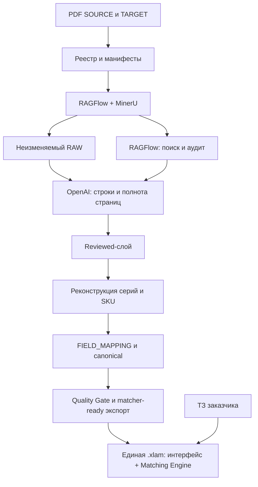

# CatalogFlow: manufacturer catalog library

The current workbench uses **local upload detection → MinerU on CPU → page reviews → manufacturer mapping → structured tools → duplicate comparison → independent final validation**. The configuration flows vertically; the top **Catalogs in work** dropdown contains a vertical queue, collapsed by default. The current processing stage is highlighted in the pipeline and navigation; the viewed section is shown separately.

## Start

```bash
[ -f .env ] || cp .env.example .env
make ui
```

Open <http://127.0.0.1:7861>. To use a Windows source folder from WSL, set this in `.env`:

```dotenv
GUHRING_CATALOG_DIR=/mnt/c/Users/senka/Desktop/Каталоги/GUHRING
```

Run `make ui` after changing the folder. It is mounted **read-only** at `/catalogs/imports/guhring` in the UI, CPU extractor and tools container. The source picker lists PDFs recursively with a **Windows · GUHRING** label. When present, `GTC_Milling_Cutters 2018.pdf` from this folder is selected initially; other catalogs stay unselected until chosen. With no configured folder, `catalogs/imports/guhring` is used. Originals are not copied or modified, and listing files does not start parsing.

The default stack contains the CPU extractor, the workbench and a local Ollama server. RAGFlow, GPU parsing, Elasticsearch, MySQL, Redis, MinIO and TEI are not needed by this pipeline.

All service containers use the `CatalogFlow_` prefix: `CatalogFlow_mineru`,
`CatalogFlow_pipeline-ui` and `CatalogFlow_local-llm` in the default stack, and
`CatalogFlow_large-cpu` on the separate inference server. Optional services and
temporary jobs launched by Make targets use the same prefix. Compose service
addresses such as `http://mineru:8000` remain valid.

### Local CPU review and final validation

New catalogs default to **local vision models for both stage 03 and stage 06**. All local requests force `num_gpu=0`; the local container has no GPU device allocation. Each task has a fresh page/tool context, the original PDF image, a fixed JSON schema and saved model execution evidence. There is no fallback to ChatGPT Work, the Platform API or Ollama cloud. Earlier saved Work runs keep their explicit choices.

| Inference RAM | Evidence review | Final validation | Approximate model weights |
| --- | --- | --- | --- |
| 32 GB | Qwen3-VL 8B Instruct Q4 | Qwen3.5 9B Q4 | 6.1 GB / 6.6 GB |
| 128 GB (optional) | Qwen3-VL 32B BF16 | Same model, fresh validation task | 67 GB |
| 750 GB | Qwen3-VL 235B-A22B Instruct BF16 | Same model, fresh validation task | 471 GB |

Only one model and one request are loaded at a time. Weight sizes are from the [Ollama Qwen3.5 library](https://ollama.com/library/qwen3.5:9b) and [Qwen3-VL library](https://ollama.com/library/qwen3-vl/tags); these presets leave room for context, images, the extractor and the OS, but are not a speed guarantee. RAM means system memory, not GPU VRAM. CPU bandwidth and core count affect runtime. The current machine must actually expose enough RAM to Linux/WSL to load the chosen model.

```bash
make local-models                   # Download both 32 GB models; no generation
make local-models MODEL_RAM=750     # Download the 471 GB model for the larger machine
# Optional persistent/resumable download of all recommended models:
python3 scripts/pull_local_models.py --ram all
```

The server stores downloads in `data/ollama/`; set `OLLAMA_DATA_DIR` to use a larger disk before recreating the local server. Progress is saved to `logs/local-model-test/downloads.json`; completed model blobs are verified by Ollama. The downloader checks the actual Windows backing drive when WSL reports virtual free space. Selecting a RAM preset does not download or load its model. Use **Check local server & models** to list installed vision models. The server URL, model pair, thinking on/off, context/output limits, temperature, image DPI and packet size are editable. Turn off **Keep model weights loaded** to release model and prompt-cache RAM after every response on small machines. Context that exceeds the configured budget is rejected rather than silently truncated.

For a separate large server, use the [CPU-only container deployment](deploy/large-cpu/README.md).
Run `make cpu-server-package` to create a transferable image archive and Compose
files in `dist/catalogflow-large-cpu/`. The image contains no weights, removes GPU
backends and starts without downloading a model. The large model's official
download is [Qwen3-VL 235B-A22B Instruct BF16](https://ollama.com/library/qwen3-vl:235b-a22b-instruct-bf16).
On this workstation, downloaded blobs are in `data/ollama/models/blobs/` and
registered models in `data/ollama/models/manifests/`.

Both review model menus offer **No model · leave unvalidated**. If selected for
stage 03, page correctness/completeness, internet verification and model-assisted
mapping are skipped. Stage 06 can be disabled independently. Extraction,
structuring, duplicate comparison and workbook integrity still run; any skipped
model checks keep the catalog unvalidated. No cloud fallback is used.

Supply precise HTTPS manufacturer product/catalog URLs or an optional private SearXNG server for internet checks. HTML and bounded PDF evidence are fetched and saved for the local model. A citation can only support a passed internet check if its source was actually retrieved. Missing sources stay **unverified**, and unresolved findings keep a catalog unvalidated. Local model self-reported confidence does not establish correctness.

Run a real selected-page test, including both models and final validation:

```bash
python3 scripts/local_real_test.py
# For a small WSL instance only: stop the idle extractor after extraction,
# then automatically restore it after unloading the review model:
python3 scripts/local_real_test.py --release-extractor
# Continue an interrupted test with completed checks retained:
python3 scripts/local_real_test.py --release-extractor --resume RUN_ID
```

This uses physical page 4 of the original CFK catalog, containing dimensioned drawings and two tool tables, plus live official manufacturer PDFs. It makes real local model calls, checks that Ollama reports zero VRAM usage, and writes the requests, model results and a report under `logs/local-model-test/`. It is a selected-page test, not a declaration that the complete catalog is validated. No model responses are simulated in this run.

Final validation checks parameter-bearing tools in small independent groups. Rows with no normalized parameters receive a bounded source-page audit covering their missing data and row classification. These rows remain unverified; the model cannot approve absent values. This avoids repeating the same incomplete-data check for every placeholder row.

Local review requires no Codex CLI, ChatGPT login or Work worker. The older Work backend remains available explicitly: `make start WORK_REVIEW_WORKER=1` (also accepted by `make ui`, `make update` and `make restart`) starts its host service with the pipeline. Plain startup uses only the local CPU path. The optional Work service waits without dispatching reviews while the workbench is offline. If the workbench goes offline during a Work review, that review is stopped and its reason is saved.

Sign in once on the **host** before automatic review:

```bash
codex login                 # Sign in with ChatGPT, not an API key
make review-worker          # Optional: start/recover the host service independently
```

No separate terminal is required. Use `make review-worker-status` for its status, `make review-worker-logs` for its log, or `make review-worker-stop` to stop the host service explicitly. Linux/WSL needs a running systemd user manager. Starting the service alone does not resume stopped catalogs or create review tasks.

The host needs Codex CLI, Python 3, `requests` and `jsonschema`. Credentials stay in the host's Codex credential store; they are not mounted into Docker. Automatic reviews explicitly select the stage's Work model and reasoning effort, a fresh ephemeral session, read-only permissions and the current bounded task. **Medium** reasoning is the default. Platform API keys are removed from the review environment. There is no paid-API fallback. Subscription limits apply. See [OpenAI authentication](https://learn.chatgpt.com/docs/auth) and [non-interactive mode](https://learn.chatgpt.com/docs/non-interactive-mode).

Stages **03** and **06** each have an independent engine, model and reasoning setting. Both default to the local CPU model pair above. Local thinking-capable models offer off/on; Instruct models have thinking disabled. The optional Work backend offers only the levels advertised for the selected account model. Deeper reasoning uses more CPU time or Work allowance, depending on the engine. CPU extraction has its own model dropdown and no LLM reasoning setting.

The Normal/ordinary Chat mode has been removed. **Automatic local CPU review is the default** for new runs. If Work is explicitly selected, its automatic-review toggle uses the signed-in subscription worker; turning that toggle off prepares manual Work handoff packets. Choosing **No model** in stage 06 disables its reasoning slider, skips final model validation, keeps workbook integrity checks, and leaves the catalog unvalidated. Changing settings makes no generation calls. Saved runs retain their explicit settings; older Work runs are not silently converted to local runs.

Refresh Work model choices and supported reasoning levels from the local account's model metadata, optionally reading the OpenAI API model list:

```bash
make refresh-models
make refresh-models MODEL_ARGS='--api' # GET /v1/models only; no generation
```

API model IDs are stored separately because API availability does not establish Chat or Work access. API discovery reads the host's `OPENAI_API_KEY` or existing `.env`; credentials are not mounted into the UI or passed to the subscription worker's inference process. The worker watches its local model cache for changes. Use **Reload available models** in the UI after refreshing. Saved runs keep their explicit model choices.

## Catalogs and manufacturers

**Pause parsing / Resume parsing / Stop parsing** beside Catalogs in work control the whole queue. Pause finishes and saves the current CPU page before waiting, retains the catalog's position, and prevents queued catalogs from starting. Resume continues without repeating completed pages. Stop cancels the active catalog and all waiting catalogs; finished page artifacts remain available for **Resume saved run**. An in-flight CPU page can finish caching in the extractor after Stop. Individual **Pause catalog / Resume catalog / Stop catalog** controls are available in each dropdown row and Run results. A paused queued catalog is skipped until resumed. Pauses also hold later pipeline steps and exclude paused time from the review-response timeout. Pausing or stopping makes no new model calls.

Expand **Why stopped** (or **Why paused**) on the affected pipeline stage to see the saved reason, catalog, PDF page when known, and stop time when recorded. Failure details include a bounded stage-output excerpt and any saved reviewer error, with a full log download when available. The dropdown stays open during polling. Interrupted older runs recover their stage from saved progress; older stages appear under Run results. These diagnostics make no model calls.

- Choose one **target manufacturer** for the library. Assign a source manufacturer to every PDF; the manifest role follows that choice for the run.
- Upload multiple PDFs or select existing files. The directory includes 55 cutting-tool manufacturers and supports additions. It is an extensible directory, not an exhaustive world census.
- Upload preflight reads native text from at most the first three pages, with 120-DPI CPU Tesseract OCR when the cover or scan needs it. Manufacturer/language suggestions are cached by PDF fingerprint and stay editable. An unchanged size/mtime lookup avoids rereading large PDFs for suggestions; source provenance still verifies the full PDF hash. Ambiguous brands and unreadable languages remain unknown. No external model is used for detection.
- **Catalog ID** is generated from manufacturer and PDF fingerprint. It links inventory, extraction caches, review evidence and library records. Re-uploading identical bytes for that manufacturer refers to the same catalog.
- **Languages for processing** defaults to selected **English, Russian and Chinese** (`en,ru,zh`). Toggle languages individually; clearing them uses automatic detection. Each PDF separately shows its detected language and allows correction. That correction takes precedence, and the actual source language selects the OCR writing-system group. **Revision** identifies the edition/year; **families** select tool schemas. Revision and families live under Catalog details.
- Extraction defaults to the **entire catalog**. Turn on **Choose specific pages** to reveal page bounds. Numbers refer to physical PDF pages, starting at 1. Partial runs remain incomplete for validation/publication.

The library stores manufacturers, catalog editions, processing status, runs and structured products in `catalogs/library/library.sqlite`. Historical manifests are imported as previously parsed, without treating their older/dry-run reviews as current validation. Each run retains its original target selection for provenance.

## Extraction quality

The installed extraction bundle is `mineru-3.4.5-pipeline`; the workbench accepts CPU only. Model selection is distinct from extraction method (`auto`, native text, OCR). The review model is selected separately.

Parameters include tables, formulas, OCR language, confidence threshold, automatic quality, maximum passes, time limit and cache refresh. Automatic quality measures native-text coverage and available **text OCR** scores, excluding layout detection scores. Below the threshold it tries another CPU text/OCR method and retains the stronger result without reducing captured table cells. Every attempt is immutable and the selected page/cache identity is pinned. These are diagnostic confidence signals, not calibrated probabilities of correctness.

Review image DPI and the size of review packets control visual evidence and context. Every page task includes its original image; final validation uses at most five tools per packet. Records are split by both count and serialized size. Context and page-image hashes bind results to their actual evidence.

## Required reviews and mapping

1. **Page correctness:** every extracted value, column alignment, unit, fit and tolerance compared with the original page.
2. **Page completeness:** all tables, rows, figures, headings and footnotes accounted for using the complete page inventory.
3. **Internet verification:** current official manufacturer sources, precise citations and revision differences.
4. **Manufacturer mapping:** manufacturer- and series-specific parameter rules and concise symbol definitions. Definitions include geometry, units, family/series scope, PDF/web evidence and verification status. Missing coating/material definitions require official internet evidence during mapping review. Unsupported meanings remain proposed.
5. **Final tool validation:** an independent fresh session checks tool identities, parameter letters and values, dimensioned images, original PDF, official internet sources and duplicate candidates.
6. **Workbook integrity:** reopen and validate RAW and every structured workbook.

Page review is always enabled. Final model validation may explicitly be set to **No model**, which prevents validated status. Results are schema validated and must cover the assigned checks. Low confidence, unavailable sources, mismatched contexts and unresolved findings do not count as approval. Reviews with findings are retained and subsequent review stages still run. A failed provider or malformed response is an operational failure, with the task and evidence saved.

Each manufacturer has its own editable mapping and a normalized Excel list: **worksheet 1 is products; worksheet 2 is dictionary**. The dictionary is part of that manufacturer list, with a collapsed worksheet preview in the UI. Profiles preserve prior versions. Old profiles that contain field codes but no geometric definitions display that gap explicitly. Mapping proposals require review and retain the publication gates.

## What Structure does

Structure contains the data transformation, rather than paths and publication switches:

| Output | Purpose |
| --- | --- |
| RAW | Unchanged parser values, table coordinates and PDF/page provenance |
| Reviewed | Source data and review/decision state |
| Canonical | Tool identities, typed attributes, units, relations, evidence and issues |
| Structured | Wide tool table for analysis |
| Matcher | Only tools that meet the existing matcher publication contract |

Duplicate candidates compare complete available parameter sets, canonical units, fit classes and tolerances. Same-name conflicts are shown with both parameter sets. Missing parameters do not prove equality. Candidates remain separate records; no tools are silently merged. The manufacturer definitions still need review before cross-manufacturer engineering equivalence can be established.

**Quality blocked** means processing produced review findings or publication blockers. It does not mean the catalog's engineering values have been accepted. Draft catalogs, unknown revisions, incomplete inventory, unapproved mappings and missing golden expectations continue to block matcher publication. The workbench does not invent publication approvals.

## Results and tests

The top dropdown preserves its open state across polling and shows active/queued catalogs vertically. Each catalog has an independent progress indicator, settings, stage results, findings and downloads. The stage banner and **Go to current stage** follow the selected run; the sidebar also marks the section currently viewed. Catalogs run sequentially. Queued catalogs can be cancelled independently. An interrupted/failed run can continue its unfinished stages with **Resume saved run**, retaining completed review evidence. **Reuse settings** starts a new run, retaining matching CPU extraction caches.

Every configuration parameter has a small help popover. Findings and log panels retain their open state across progress polls. Catalog **average/worst confidence** uses the minimum extraction/review score on each assessed page; coverage and the worst page are shown. These scores are diagnostics, not calibrated correctness probabilities, and missing pages or skipped reviews remain unvalidated.

**Prepare for manual review** creates evidence for every normalized tool, including unresolved candidates. **Open manual tool review** in stage 03 opens a workspace with a searchable/filterable tool list, an original PDF page viewer with zoom, and Parameters/Findings/Internet tabs. Previous/Next (or arrow keys), **Next unchecked**, and the remembered tool position make long lists easier to review. **Mark checked**, **Needs correction** and notes persist in `manual-decisions.json`, bound to the tool snapshot and source PDF. Changed evidence invalidates the check while retaining previous notes; these human notes do not approve or alter canonical values, mappings or publication gates. Missing and page-scoped internet evidence are labelled explicitly. Preparing or browsing evidence makes no model calls.

Waiting page/final tasks appear at their pipeline stage with **Continue review**. Each task offers a ZIP packet containing the prompt, schema, request and original image, a copy button, and pasted/file JSON import. Provide each bounded packet to a fresh ChatGPT session; a valid response continues the pipeline.

Runs are isolated in `logs/ui-runs/<run-id>/` and `parsed/ui-runs/<run-id>/`; shared RAW, production manifests and original mapping files are preserved. Review tasks and their fresh-session execution evidence live in `logs/review-queue/<task-id>/`. Keep the workbench bound to localhost.

```bash
make test
# Browser dependencies, installed outside the project:
npm install --prefix /tmp/catalog-ui-browser playwright@1.55.1
/tmp/catalog-ui-browser/node_modules/.bin/playwright install chromium
NODE_PATH=/tmp/catalog-ui-browser/node_modules node tests/ui_e2e.cjs
# Regression suite + real page-7 CPU probe, without Work generation:
make full-test
make full-test TEST_ARGS='--source "/catalogs/imports/guhring/GTC_Milling_Cutters 2018.pdf" --first-page 7 --last-page 7'
# Optional fresh extraction without reusing a cached page (no Work calls):
docker compose run --rm --no-deps --name "CatalogFlow_task_$(date +%s%N)" tools python /scripts/local_workbench_probe.py \
  --source '/catalogs/imports/guhring/GTC_Milling_Cutters 2018.pdf' \
  --first-page 7 --last-page 7 --force
# Explicit opt-in for a full catalog with real Work reviews:
make full-test TEST_ARGS='--allow-work-generation'
```

The browser suite covers upload metadata, parameter popovers, independent models, panel/dropdown persistence, stage navigation, searchable review evidence and notes, manufacturer selection, page defaults, themes, desktop/mobile layouts and multi-catalog progress. Python tests include real image-only CPU OCR, queue cancellation, review/context gates, duplicate signatures, two-sheet manufacturer lists and actual ETL generation. Fixture review responses are simulated. By default, `full-test` uses no Work generation; real reviews require `--allow-work-generation`. Its opt-in review mode returns 3 for quality blockers and 1 for operational failures.

The removed services' persistent data is retained. Older optional RAGFlow/GPU/API commands below require the separate legacy compose file:

```bash
export COMPOSE_FILE=docker-compose.yml:docker-compose.legacy.yml
export COMPOSE_PROFILES=cpu,elasticsearch,metadata-mysql,tei-cpu
# Start this only when deliberately testing the old optional integration:
make legacy-start
make legacy-full-test
```

The specification and historical implementation evidence below describe the existing workbook/publication contracts and older optional integrations. The current workbench behavior is documented above.

# Часть 1. Техническое задание

## 1. Паспорт документа

| Параметр | Значение |
|---|---|
| Наименование | Система стандартизованного парсинга каталогов режущего инструмента |
| Назначение | Подготовка проверенных каталогов для подбора аналогов в единой Excel-надстройке `.xlam` |
| Статус | Проект ТЗ; подлежит уточнению и утверждению по открытым вопросам раздела 20 |
| Производственный профиль | Gühring |
| Целевые источники | Каталоги Gühring, PROMATOOL и других утверждённых производителей |
| Роли каталогов | `SOURCE` и `TARGET` |
| Основные технологии | Docker Compose, RAGFlow, MinerU, Python, OpenAI API, XLSX |
| Основной результат | Версионированный matcher-ready каталог с полной трассировкой до PDF |
| Внешний потребитель | Единая `.xlam`, внутри которой находятся интерфейс и Matching Engine |

Уровни обязательности требований:

- **MUST** — обязательное условие приёмки;
- **SHOULD** — требуется, если не согласовано обоснованное исключение;
- **MAY** — допустимое расширение после MVP.

Обозначения статуса текущей реализации:

- ✅ — реализовано и проверено;
- 🟡 — реализовано частично;
- ⬜ — требуется реализовать;
- ➖ — находится за границами данного репозитория.

## 2. Основание и бизнес-цель

Заказчику требуется подбирать замену используемому зарубежному режущему инструменту. Для этого система должна подготовить достоверные и сопоставимые данные из каталогов исходных производителей и целевого производителя.

Бизнес-результат полного решения:

1. Пользователь передаёт ТЗ и/или обозначение используемого зарубежного инструмента.
2. `.xlam` находит точную исходную позицию и восстанавливает её технический профиль из стандартизованного `SOURCE`-каталога.
3. Та же `.xlam` ищет технически допустимые позиции в стандартизованном `TARGET`-каталоге.
4. Пользователь получает аналоги, критические различия, недостающие данные, оценку соответствия и ссылку на первоисточник.
5. При нарушении обязательных параметров система возвращает «аналог не найден», а не наиболее похожую несовместимую позицию.

Данный репозиторий отвечает за достоверную подготовку каталогов и контракт передачи данных в `.xlam`. Логика подбора и интерфейс пользователя являются одной Excel-надстройкой; отдельный REST API или отдельный Matching Service не предусматриваются.

## 3. Границы проекта

### 3.1. Входит в объём работ

- инвентаризация всех входных PDF и их редакций;
- одинаковая обработка каталогов `SOURCE` и `TARGET`;
- извлечение текста, таблиц, изображений, координат и структуры страниц через MinerU;
- сохранение неизменяемого RAW-слоя;
- восстановление многостраничных таблиц и контекста;
- классификация смыслового типа строк;
- формирование серий, SKU, комплектов, компонентов и связей совместимости;
- два режима OpenAI-проверки: проверка извлечённых строк и поиск полностью пропущенных данных;
- ручное принятие или отклонение спорных исправлений;
- `FIELD_MAPPING` для производителя и семейства инструмента;
- canonical-нормализация значений, единиц, диапазонов и допусков;
- проверка полноты, дублей, конфликтов и происхождения данных;
- matcher-ready XLSX-экспорт для `.xlam`;
- сравнение редакций каталогов;
- поиск и аудит первоисточников через RAGFlow;
- отчёты качества, журналы, воспроизводимость и резервное копирование.

### 3.2. Не входит в объём данного репозитория

- интерфейс `.xlam` и VBA-код Matching Engine;
- отдельный серверный Matching API;
- принятие инженерного решения вместо специалиста при недостатке данных;
- автоматическое получение цен, остатков и сроков поставки, если не подключён отдельный утверждённый источник;
- изменение исходных PDF;
- гарантированное автоматическое разрешение неоднозначных строк без ручной проверки.

### 3.3. Обязательный интеграционный контракт

Парсер MUST формировать `master_matcher.xlsx` по согласованной схеме. `.xlam` MUST читать этот файл без повторного OCR и без обязательного вызова OpenAI во время подбора.

Если `.xlam` выполняет дополнительную импортную нормализацию, она не должна изменять смысл утверждённых canonical-полей и обязана сохранять версию каталога и `FIELD_MAPPING`.

## 4. Термины и сущности

| Термин | Определение |
|---|---|
| Каталог | Один логический выпуск производителя, представленный одним или несколькими PDF |
| Документ | Конкретный неизменяемый PDF с SHA-256 |
| Редакция | Версия каталога с датой или иным идентификатором выпуска |
| `SOURCE` | Каталог исходного зарубежного инструмента |
| `TARGET` | Каталог, из которого выбирается замена |
| Семейство | Тип инструмента с общими правилами интерпретации параметров |
| Серия | Группа изделий производителя с общей геометрией или назначением |
| SKU | Заказываемая товарная позиция или однозначный вариант изделия |
| Компонент | Самостоятельная позиция, являющаяся частью сборки |
| Комплект | Комбинация компонентов, поставляемая или применяемая совместно |
| RAW | Неизменённый результат извлечения с полным происхождением данных |
| Reviewed | RAW с предложениями, решениями и историей проверки |
| Canonical | Нормализованное представление товара и его атрибутов |
| Matcher-ready | Детерминированный экспорт, согласованный с `.xlam` |
| `FIELD_MAPPING` | Версионированное правило преобразования исходного поля в canonical-поле |
| Evidence | Фрагмент текста или область страницы, подтверждающая значение |
| Golden set | Вручную утверждённая эталонная выборка для регрессионных тестов |

## 5. Целевая архитектура



Распределение ответственности:

| Компонент | Ответственность | Не должен использоваться для |
|---|---|---|
| MinerU | Извлечение структуры PDF, текста, таблиц, bbox и изображений | Семантического подбора аналогов |
| RAGFlow | Управление документами, поиск контекста, аудит и навигация к первоисточнику | Перечисления всех SKU каталога |
| Детерминированный ETL | Последовательный обход, реконструкция, типизация, нормализация и контроль | Генерации неподтверждённых значений |
| OpenAI API | Визуальная проверка, разбор неоднозначностей, поиск пропусков | Незаметной перезаписи RAW |
| Ручная очередь | Разрешение конфликтов и критических неоднозначностей | Массового повторного ввода очевидных данных |
| `.xlam` | Импорт ТЗ и каталогов, Matching Engine, ранжирование, объяснение и результат | OCR и массовой подготовки каталогов |

## 6. Основные принципы

1. **Полнота важнее удобства экспорта.** Все файлы, страницы и необработанные области должны быть учтены.
2. **RAW неизменяем.** Исправления сохраняются рядом с исходным значением и никогда не стирают его.
3. **Никаких догадок без маркировки.** Неизвестное значение остаётся пустым или получает `requires_review`.
4. **Одна строка PDF не равна одному SKU.** Сначала определяется смысл строки, затем формируется товарная позиция.
5. **`SOURCE` и `TARGET` равноправны.** Различается их роль в подборе, но не качество и схема обработки.
6. **Каждое опубликованное поле доказуемо.** Значение должно вести к документу, странице, таблице, строке/ячейке и bbox.
7. **Результат воспроизводим.** Одинаковые PDF, конфигурация, версии моделей, mapping и код дают одинаковый опубликованный результат.
8. **LLM не является единственным валидатором.** Типы, диапазоны, единицы, уникальность и связи проверяются кодом.
9. **Конфликт не разрешается молча.** Все расхождения видимы в отчёте и истории решений.
10. **Релиз блокируется критической неопределённостью.** Позиция с нерешённым критическим полем не получает статус `published`.

## 7. Входные данные

### 7.1. PDF-каталоги

Для каждого каталога MUST предоставляться исходные PDF без предварительного OCR-переупаковывания, если доступен оригинал производителя. Файлы регистрируются до разбора и не заменяются без изменения SHA-256.

Система MUST поддерживать:

- текстовые и сканированные PDF;
- русский, английский и немецкий языки как минимум;
- многостраничные таблицы;
- объединённые заголовки;
- вертикальный и повёрнутый текст;
- пиктограммы и сноски, влияющие на характеристики;
- несколько логических каталогов одного производителя;
- дублирующиеся позиции в разных документах и редакциях.

### 7.2. Манифест каталога

Каждый импорт MUST иметь машинно-читаемый манифест. Минимальный пример:

```yaml
schema_version: "1.0"
catalog_id: "promatool-2026-main"
manufacturer: "PROMATOOL"
catalog_role: "TARGET"
revision: "2026"
publication_date: "2026-01-01"
languages: ["ru"]
documents:
  - file: "Каталог PROMATOOL-2026 web.pdf"
    sha256: "<вычисляется системой>"
mapping_profile: "promatool"
tool_families:
  - drills
  - milling_cutters
  - inserts
  - holders
status: "registered"
```

Обязательные поля манифеста:

| Поле | Требование |
|---|---|
| `schema_version` | Версия схемы манифеста |
| `catalog_id` | Уникальный стабильный идентификатор логического каталога |
| `manufacturer` | Каноническое имя производителя |
| `catalog_role` | Только `SOURCE` или `TARGET` |
| `revision` | Редакция каталога; `unknown` допустимо только до ручного уточнения |
| `documents` | Полный упорядоченный перечень PDF |
| `mapping_profile` | Профиль нормализации производителя |
| `tool_families` | Заявленные семейства или `unknown` до классификации |

Система SHOULD хранить URL официального источника, дату загрузки, язык, валюту, регион, период действия и примечания об изъятых/заменённых редакциях.

### 7.3. Эталонные данные

До промышленного импорта каждого нового производителя MUST быть подготовлен golden set, включающий:

- простые и сложные страницы;
- минимум по одному примеру каждого семейства MVP;
- объединённые и многостраничные таблицы;
- диапазоны, допуски и ведущие нули;
- серию без SKU и серию с размерными вариантами;
- составную оснастку и связь совместимости, если она есть в каталоге;
- заведомо ошибочные и пропущенные результаты для проверки валидаторов.

Размер golden set утверждается для каждого производителя отдельно. Он должен покрывать все найденные типы макетов, а не только случайное число страниц.

## 8. Функциональные требования

### FR-001. Реестр и инвентаризация

Система MUST:

- присваивать документу стабильный `document_id` и вычислять SHA-256;
- фиксировать число физических страниц до парсинга;
- выявлять полные дубли файлов;
- связывать документы с каталогом, ролью и редакцией;
- хранить статус обработки каждой страницы;
- запрещать публикацию каталога, если есть неучтённый файл или страница.

### FR-002. Последовательный полный проход

Полный импорт MUST обходить каждый документ по схеме:

```text
каталог → документ → физическая страница → область → таблица → строка → ячейка
```

RAG-поиск не может считаться механизмом полного извлечения. Если область не удалось распознать, она MUST попасть в отчёт как необработанная, а не исчезнуть.

### FR-003. Извлечение MinerU

Для каждой страницы система MUST по возможности сохранять:

- текст и Markdown;
- таблицы HTML/JSON;
- `middle.json` и model output;
- изображения и визуальные области;
- порядок блоков;
- bbox и систему координат;
- номер физической страницы;
- версию MinerU, backend, модель и параметры;
- исходный ZIP и хеш результата.

Результат каждой попытки должен быть неизменяемым. Повторный запуск с тем же ключом использует только полностью проверенный кэш.

### FR-004. Документная реконструкция

Поверх постраничного кэша MUST быть реализован отдельный этап, который:

- связывает продолжения таблиц на соседних страницах;
- переносит контекст заголовков только при доказуемой связи;
- распознаёт повторяющиеся заголовки как заголовки, а не товарные строки;
- связывает сноски, легенды и пиктограммы с затронутыми строками;
- сохраняет границы исходных страниц и evidence;
- не изменяет исходные постраничные артефакты.

Критерии связи SHOULD учитывать геометрию, заголовки, порядок страниц, серию, повторяемость колонок и явные маркеры продолжения.

### FR-005. Классификация строк

До формирования SKU каждая логическая строка MUST получить один из типов:

- `family_header`;
- `series_header`;
- `sku`;
- `size_variant`;
- `price`;
- `kit`;
- `component`;
- `compatibility_relation`;
- `note`;
- `table_header`;
- `continuation`;
- `unknown`.

Тип `unknown` допустим в Reviewed-слое, но блокирует автоматическую публикацию строки как SKU.

### FR-006. Формирование товара

Реконструктор MUST:

- различать артикул, заказной номер, код размера, обозначение серии и цену;
- собирать характеристики из заголовка, строки, сноски и контекста страницы;
- поддерживать несколько идентификаторов одной позиции;
- отличать один SKU с несколькими атрибутами от нескольких SKU;
- выявлять ошибочные объединения и разбиения;
- сохранять `product_key` между редакциями;
- создавать отдельный `product_version_id` для конкретного выпуска.

Если уникальный товарный ключ не доказан, создаётся временная сущность с `requires_review`, но не опубликованный SKU.

### FR-007. OpenAI row validation

Режим `row_validation` MUST:

- получать исходные извлечённые строки и соответствующую PDF-страницу или crop;
- использовать строгий структурированный JSON;
- возвращать результат для каждого входного `row_id`;
- указывать вердикт, confidence, проблему, предлагаемое значение и evidence;
- не добавлять отсутствующую входную строку как подтверждённый SKU;
- сохранять модель, версию промпта, request/response id, хеши и кэш.

Допустимые вердикты:

```text
ok
suspicious
incorrect
missing_context
```

### FR-008. OpenAI page completeness

Отдельный режим `page_completeness` MUST находить данные, которым MinerU не присвоил `row_id`:

- визуально присутствующие, но пропущенные строки;
- пропущенные правые или нижние части таблицы;
- отсутствующие номера изделий;
- заголовки, единицы, сноски и пиктограммы, меняющие смысл;
- расхождение между визуальным и извлечённым количеством строк/колонок.

Найденные элементы создаются как `proposed_missing_element`, содержат bbox/evidence и требуют детерминированной или ручной проверки до публикации.

### FR-009. Принятие исправлений

Система MUST хранить отдельно:

- исходное значение;
- предложение MinerU/VLM/OpenAI/правила;
- принятое значение;
- автора решения: `rule`, `openai`, `reviewer`;
- дату, причину и версию правила;
- статус `accepted`, `rejected`, `requires_review` или `not_applicable`.

Confidence модели не является достаточным основанием для автоматической публикации. Автопринятие допускается только для утверждённых типов исправлений с evidence и регрессионным тестом.

### FR-010. FIELD_MAPPING

Mapping MUST быть внешним, версионированным и контекстным:

```text
производитель + семейство + исходный путь заголовка
→ canonical field + тип + единица + правило преобразования
```

Минимальный пример:

```yaml
mapping_schema_version: "1.0"
mapping_profile: "promatool"
mapping_version: "2026.1"
manufacturer: "PROMATOOL"
rules:
  - family: "drills"
    raw_header: "d1"
    canonical_field: "cutting_diameter"
    data_type: "decimal"
    source_unit: "mm"
    canonical_unit: "mm"
    transform: "decimal_comma"
    criticality: "hard"
```

Mapping MUST:

- сохранять исходное обозначение и полный путь заголовка;
- учитывать производителя, семейство и при необходимости серию;
- запрещать глобальное толкование `d1`, `d2`, `l1`, `l2` без контекста;
- иметь версию и журнал изменений;
- выявлять конфликтующие правила;
- отправлять неизвестное или неоднозначное поле в очередь проверки.

### FR-011. Canonical-нормализация

Нормализация MUST:

- хранить артикулы и заказные номера как строки, включая ведущие нули;
- разделять исходное, отображаемое и машинное значение;
- поддерживать `value_text`, `value_decimal`, `value_min`, `value_max`;
- хранить нижний и верхний допуск раздельно;
- хранить исходную и canonical-единицу;
- нормализовать десятичную запятую без изменения RAW;
- различать материал инструмента, покрытие, сплав пластины и материал заготовки;
- различать номинал, диапазон, допуск, посадку и класс точности;
- поддерживать направления, внутреннюю СОЖ, стандарты, интерфейсы и группы `P/M/K/N/S/H`;
- сохранять `null` как неизвестное и не заменять его нулём, дефисом или догадкой.

### FR-012. Составные изделия и совместимость

Для оснастки система MUST моделировать сущности и связи, а не превращать все строки в независимые аналоги.

Минимальные типы связей:

```text
consists_of
compatible_with
uses_insert
uses_cartridge
uses_holder
replacement_for
supersedes
```

Связь MUST иметь направление, источник, редакцию, confidence и review status. Пример: корпус, расточная головка, картридж и пластина сохраняются как отдельные позиции только при наличии собственных товарных идентификаторов, а их совместимость — отдельными отношениями.

### FR-013. Контроль качества

Валидатор MUST проверять:

- покрытие файлов и страниц;
- число обнаруженных и обработанных областей/таблиц;
- пустые и подозрительные ячейки;
- дубли RAW, SKU и идентификаторов;
- конфликтующие значения одного поля;
- обязательные поля семейства;
- допустимые типы, единицы и диапазоны;
- ссылки на отсутствующие компоненты;
- разрывы продолжений таблиц;
- позиции без evidence;
- позиции без утверждённого mapping;
- стабильность результата при повторном экспорте.

Все исключённые строки MUST присутствовать в отчёте с причиной исключения.

### FR-014. Экспорт слоёв

Система MUST создавать четыре независимых результата:

1. `master_raw.xlsx` — неизменяемое извлечение MinerU.
2. `master_reviewed.xlsx` — RAW, предложения и решения проверки.
3. `master_canonical.xlsx` — товары, атрибуты и связи в canonical-модели.
4. `master_matcher.xlsx` — утверждённый экспорт в контракте `.xlam`.

Публикация нового слоя не должна изменять ранее выпущенные файлы. Каждый файл MUST содержать `_manifest` с версиями входов, кода, парсера, модели, промпта, mapping, схемы и хешем содержимого.

### FR-015. Сравнение редакций

Для двух выпусков одного каталога система MUST формировать отчёт:

- добавленные позиции;
- удалённые позиции;
- изменённые идентификаторы;
- изменённые значения атрибутов;
- изменённые связи совместимости;
- позиции, которые не удалось сопоставить;
- объяснение ключа сопоставления.

Исчезновение позиции из новой выгрузки не считается реальным удалением, пока не исключена ошибка парсинга.

### FR-016. RAGFlow-поиск и аудит

RAGFlow SHOULD использовать мультиязычные эмбеддинги, подходящие для русского, английского и немецкого. Текущая `BAAI/bge-small-en-v1.5` обеспечивает автономный локальный контур, но для мультиязычного семантического поиска должна быть заменена утверждённой multilingual-моделью без изменения parsing/ETL-контура.

RAGFlow MUST позволять:

- найти исходную страницу по артикулу или параметру;
- открыть контекст серии и соседние страницы;
- проверить объяснение спорного mapping;
- сопоставить canonical-значение с evidence.

RAGFlow не может быть единственным источником списка товаров или метрики полноты.

### FR-017. Возобновление и повторные запуски

После сбоя система MUST продолжать с последнего подтверждённого этапа без повторной оплаты уже успешно закэшированных OpenAI-пакетов и без повторного MinerU-разбора неизменившихся страниц.

Повреждённый или неполный кэш MUST игнорироваться. Принудительный повторный запуск создаёт новую попытку и не удаляет старую.

## 9. Контракт данных

### 9.1. Идентификаторы

Минимальные идентификаторы:

| Идентификатор | Назначение |
|---|---|
| `catalog_id` | Логический каталог |
| `document_id` | Конкретный PDF, основанный на SHA-256 |
| `raw_element_id` | Стабильная ячейка/блок в контексте документа и страницы |
| `logical_row_id` | Реконструированная логическая строка |
| `product_key` | Стабильное соответствие товара между редакциями |
| `product_version_id` | Товар в конкретной редакции каталога |
| `attribute_id` | Конкретное значение атрибута товара |
| `relation_id` | Связь между товарами или компонентами |
| `review_decision_id` | Решение по предложению или конфликту |

`product_key` SHOULD строиться из утверждённого идентификатора производителя, например manufacturer + order number + family. Редакция не включается в стабильный ключ, но включается в `product_version_id`.

Если надёжного идентификатора нет, система MUST использовать помеченный provisional key и запретить автоматическое слияние между редакциями.

### 9.2. RAW-слой

Для каждого элемента MUST сохраняться как минимум:

```text
catalog_id
catalog_role
catalog_revision
manufacturer
source_file
source_sha256
page
page_idx
table_index
row_index
column_index
bbox
bbox_units
raw_header_path
raw_text
raw_value
raw_unit
parser
parser_version
backend
model_revision
cache_key
artifact_path
extraction_status
```

### 9.3. Reviewed-слой

Reviewed-слой MUST добавлять:

```text
row_id
validation_mode
verdict
confidence
issues
proposed_value
evidence
review_status
accepted_value
decision_source
decision_reason
prompt_version
model_id
response_id
reviewed_at
```

### 9.4. Canonical-слой

Рекомендуется гибридная модель:

- таблица `products` — устойчивые поля товара;
- таблица `attributes` — типизированные canonical-атрибуты;
- таблица `relations` — состав и совместимость;
- таблица `provenance` — связь каждого опубликованного значения с RAW/evidence;
- таблица `issues` — нерешённые конфликты и исключения.

Обязательные поля `products`:

```text
product_key
product_version_id
catalog_id
catalog_role
catalog_revision
manufacturer
family
subfamily
series
item_type
article_number
order_number
size_code
standard
publication_status
data_confidence
```

Обязательные поля `attributes`:

```text
product_version_id
canonical_field
value_type
value_text
value_decimal
value_min
value_max
tolerance_lower
tolerance_upper
raw_unit
canonical_unit
mapping_profile
mapping_version
criticality
confidence
review_status
provenance_id
```

### 9.5. Matcher-ready экспорт

Точная структура согласуется с разработчиком `.xlam`. До согласования экспорт MUST как минимум содержать:

- стабильный UID и идентификаторы товара;
- производителя, роль и редакцию каталога;
- семейство, подсемейство, серию и тип записи;
- артикул, заказной номер и код размера;
- canonical-атрибуты;
- исходные обозначения параметров;
- значения, единицы, диапазоны и допуски;
- связи совместимости;
- статус публикации и confidence;
- источник, PDF-страницу, bbox и evidence;
- версии схемы, mapping и каталога.

Для совместимости с существующим Gühring-шаблоном MAY формироваться широкий лист с `UID`, `Код`, `Артикул`, `Заказной номер`, `Серия`, `d1…`, `l1…`, `Источник`, `Страница каталога`, `PDF стр.`. Этот лист является представлением canonical-данных, а не первичной моделью хранения.

## 10. Правила публикации данных

Позиция получает статус `published`, только если:

1. определён допустимый тип записи;
2. доказан товарный идентификатор или утверждён исключительный ключ;
3. заполнены критические поля соответствующего семейства либо явно подтверждена их неприменимость;
4. все опубликованные значения имеют provenance;
5. mapping существует и не конфликтует;
6. нет нерешённых критических ошибок;
7. пройдены проверки дублей и связей;
8. позиция вошла в сверку количества и полноты.

Допустимые статусы:

```text
draft
requires_review
approved
published
rejected
superseded
```

`data_confidence` MUST отражать достоверность исходных данных, а не техническую пригодность аналога. `technical_match` рассчитывается позднее внутри `.xlam`.

## 11. OpenAI: требования к стоимости и качеству

Обработка SHOULD быть каскадной:

1. MinerU извлекает страницу.
2. Детерминированные правила разбирают очевидные значения.
3. Основная модель проверяет неоднозначные, но структурно понятные фрагменты.
4. Старшая модель получает только конфликтные строки и соответствующую область страницы.
5. Нерешённые случаи направляются человеку.

Обязательные ограничения:

- в обработку попадают только попытки MinerU, зафиксированные в production-манифесте;
- PDF передаётся только при явном запуске OpenAI-этапа;
- `store: false` используется, если поддерживается выбранным API;
- ключ API не хранится в коде, XLSX, журналах и артефактах;
- запрос кэшируется по данным, странице, модели, промпту и схеме;
- ответ не считается истинным только из-за высокого confidence;
- модель обязана вернуть evidence или `missing_context`;
- изменение модели/промпта создаёт новую версию результата;
- стоимость по документу, странице и запуску отражается в отчёте, если API возвращает usage.

## 12. Нефункциональные требования

### NFR-001. Развёртывание

- система MUST запускаться через Docker Compose;
- CPU-профиль MUST быть режимом по умолчанию;
- NVIDIA GPU/VLM MUST быть опциональным профилем;
- на компьютере оператора не должны требоваться отдельные установки Python, Java или Node;
- `.xlam` устанавливается отдельно в Excel и не входит в Docker-стек.

### NFR-002. Сохранность

- PDF, кэши, базы, индексы, отчёты и экспорты MUST находиться в persistent mounts;
- `docker compose down` не должен удалять пользовательские данные;
- резервная копия MUST включать входные PDF, RAW, Reviewed, canonical, mapping, журналы и манифесты;
- восстановление MUST проверяться на тестовом каталоге.

### NFR-003. Воспроизводимость

Каждый релиз MUST фиксировать:

- SHA-256 входных PDF;
- версии RAGFlow, MinerU, моделей и зависимостей;
- версии кода, схем, промптов и `FIELD_MAPPING`;
- конфигурацию запуска;
- канонический хеш строк каждого экспорта.

### NFR-004. Безопасность

- внешние порты по умолчанию публикуются только на `127.0.0.1`;
- исходные PDF подключаются к парсерам read-only;
- OpenAI-контейнер не получает доступ к внутренним БД без необходимости;
- секреты хранятся только в `.env` или утверждённом secret store;
- ZIP проверяются на path traversal, абсолютные пути и symlinks;
- журналы не содержат пароли, API keys и заголовки авторизации.

### NFR-005. Надёжность

- каждый этап MUST иметь идемпотентный повторный запуск;
- частичный сбой не должен публиковать неполный артефакт как успешный;
- успешный кэш используется только после проверки manifest и хешей;
- ошибки отдельной страницы не должны скрывать результаты остальных страниц;
- итоговый релиз блокируется, пока ошибки не классифицированы.

### NFR-006. Производительность

До утверждения SLA система MUST измерять и сохранять:

- время на страницу и документ;
- CPU/RAM/VRAM peak;
- cache hit rate;
- число и стоимость OpenAI-вызовов;
- скорость экспорта и валидации.

Целевое время полного каталога и допустимая стоимость API утверждаются по результатам производственных прогонов на реальном составе оборудования. Скорость не может достигаться за счёт пропуска страниц или отключения проверок.

### NFR-007. Расширяемость

Добавление производителя SHOULD требовать нового манифеста, mapping и golden set, но не изменения общей схемы и базового ETL. Семейно-специфичные правила должны подключаться как версии профиля.

## 13. Метрики качества и Quality Gate

| Метрика | Условие приёмки релиза |
|---|---|
| Учёт входных файлов | 100% файлов зарегистрированы и имеют SHA-256 |
| Покрытие страниц | 100% физических страниц имеют итоговый статус |
| Необъяснимые пропуски | 0 |
| Трассировка опубликованных полей | 100% полей имеют provenance |
| Нерешённые критические конфликты | 0 в опубликованном слое |
| Точность критических полей golden set | 100% либо все расхождения вручную разрешены до релиза |
| Полнота SKU golden set | 100% |
| Ошибочные merge/split SKU golden set | 0 |
| Точность некритических полей golden set | Не менее 99,5% |
| Ведущие нули и строковые идентификаторы | 100% сохранены |
| Детерминированность экспорта | Одинаковый канонический хеш при одинаковых входах |
| Исключённые строки | 100% отражены с причиной |
| Сравнение редакций | Нет необъяснённого изменения количества SKU |

Confidence OpenAI не входит в формулу фактической точности. Метрики рассчитываются только относительно утверждённого первоисточника или golden set.

Для каждого релиза MUST выпускаться отчёт, содержащий:

- число документов, страниц, таблиц, логических строк и SKU;
- число автоматически принятых, вручную принятых и отклонённых исправлений;
- очередь `requires_review` по критичности;
- ошибки полноты, дублей, mapping и связей;
- результаты golden set и регрессионных тестов;
- сравнение с предыдущей редакцией;
- версии всех входов и компонентов.

## 14. Приёмочные сценарии

| ID | Сценарий | Ожидаемый результат |
|---|---|---|
| AT-01 | Импорт `SOURCE` и `TARGET` разных производителей | Оба проходят одинаковые слои и различаются только ролью/профилем |
| AT-02 | Таблица продолжается на следующей странице без полного заголовка | Строки связаны с верным заголовком, границы страниц сохранены |
| AT-03 | MinerU полностью пропустил товарную строку | `page_completeness` обнаруживает пропуск и создаёт проверяемое предложение |
| AT-04 | Объединённые заголовки `d1/d2/l1/l2` | Логическая сетка восстановлена без подмены `l` на `1` |
| AT-05 | Артикул `00123.040` | Значение остаётся строкой и сохраняет ведущие нули |
| AT-06 | Значение `11,8 +0,02/-0,01` | Номинал и оба допуска сохранены раздельно, RAW не изменён |
| AT-07 | Корпус, картридж и пластина | Созданы товары и направленные связи совместимости, а не ложные аналоги |
| AT-08 | Одинаковый SKU в двух редакциях | Общий `product_key`, разные `product_version_id`, изменения отражены в diff |
| AT-09 | Два одинаковых запуска | Получен одинаковый canonical hash, повторный OCR/API не выполняется |
| AT-10 | Сбой на середине каталога | Повторный запуск продолжает работу с подтверждённого состояния |
| AT-11 | Конфликт ТЗ/каталога на этапе `.xlam` | Каталог сохраняет факт, `.xlam` показывает конфликт и не переписывает данные |
| AT-12 | Импорт `master_matcher.xlsx` | `.xlam` загружает файл без OCR и обязательного OpenAI-вызова |
| AT-13 | Новая редакция содержит меньше SKU | Отчёт отличает реальное удаление от ошибки/неуверенного сопоставления |
| AT-14 | Поле не имеет mapping | Позиция получает `requires_review`, поле не публикуется под выдуманным смыслом |

## 15. Тестирование

Обязательные уровни:

1. **Unit tests** — парсинг чисел, единиц, допусков, ключей, mapping и связей.
2. **Schema tests** — JSON/YAML/XLSX-контракты и обратное чтение.
3. **Golden-page tests** — точные значения и координаты на утверждённых страницах.
4. **Golden-SKU tests** — состав товаров, атрибутов и связей.
5. **Completeness tests** — искусственно удалённые строки, колонки и заголовки.
6. **Regression tests** — все исправленные ранее ошибки остаются исправленными.
7. **Restart/cache tests** — возобновление, повреждённый кэш и `--force`.
8. **Release diff tests** — добавление, удаление и изменение позиции.
9. **Integration tests** — импорт matcher-ready файла в тестовую `.xlam`.
10. **UAT** — реальные ТЗ заказчика и утверждённые правильные/неправильные аналоги.

Нельзя заменять golden set случайной выборкой. Случайная выборка MAY использоваться как дополнительный аудит полного релиза.

## 16. Результаты и комплект поставки

Разработчик должен передать:

- исходный код и Docker Compose;
- `.env.example` без секретов;
- схемы манифеста, RAW, Reviewed, canonical и matcher-ready;
- манифесты всех каталогов;
- версионированные `FIELD_MAPPING`;
- правила реконструкции семейств и SKU;
- OpenAI schemas/prompts и правила автопринятия;
- четыре XLSX-слоя каждого опубликованного каталога;
- отчёты качества и сравнения редакций;
- golden set и автоматические тесты;
- инструкцию запуска, резервного копирования и восстановления;
- журнал известных ограничений;
- интеграционный пример для `.xlam`.

## 17. Этапы реализации

### Этап 0. Project Baseline

- утвердить перечень производителей, документов и редакций;
- определить `SOURCE/TARGET`;
- утвердить семейства MVP;
- зафиксировать входной формат ТЗ и выход `.xlam`;
- сформировать golden set.

**Результат:** реестр, манифесты, словарь терминов и утверждённый data contract.

### Этап 1. Универсализация производственного профиля Gühring

- убрать Gühring-специфичные имена dataset, prompt key и эвристики из общего кода;
- добавить catalog manifest и профили производителей;
- внедрить мультиязычный поиск;
- сохранить текущую воспроизводимость и RAW.

**Результат:** одинаковый RAW-маршрут для Gühring и PROMATOOL.

### Этап 2. Документная реконструкция

- связать многостраничные таблицы;
- классифицировать строки;
- восстановить серии, SKU и варианты;
- внедрить provisional entities и очередь ошибок.

**Результат:** `master_reviewed.xlsx` с логическими строками и товарами-кандидатами.

### Этап 3. Двойная OpenAI-валидация

- сохранить текущий `row_validation`;
- добавить `page_completeness`;
- внедрить каскад моделей, evidence и учёт стоимости;
- добавить контролируемое принятие исправлений.

**Результат:** проверенный Reviewed-слой без необъяснимых пропусков.

### Этап 4. FIELD_MAPPING и canonical

- утвердить canonical-поля по семействам;
- создать mapping Gühring и PROMATOOL;
- реализовать типы, единицы, диапазоны и допуски;
- реализовать связи составной оснастки.

**Результат:** `master_canonical.xlsx`.

### Этап 5. Quality Gate и версии

- реализовать метрики полноты;
- сравнение релизов;
- golden/regression tests;
- блокирующие правила публикации.

**Результат:** воспроизводимый релиз каталога и QA-отчёт.

### Этап 6. Интеграция с `.xlam`

- согласовать matcher-ready схему;
- реализовать экспорт;
- проверить импорт, идентификаторы и provenance;
- провести UAT на реальных ТЗ заказчика.

**Результат:** `master_matcher.xlsx`, пригодный для единой `.xlam`.

## 18. Definition of Done

Каталог считается готовым для `.xlam`, если одновременно выполнены условия:

- зарегистрированы и обработаны все входные PDF и страницы;
- нет необъяснимых пропусков или скрытых исключений;
- завершена реконструкция таблиц и SKU;
- все опубликованные поля нормализованы утверждённым mapping;
- составные изделия и совместимость представлены связями;
- нет нерешённых критических конфликтов;
- golden set и регрессионные тесты пройдены;
- сравнение с предыдущим релизом не содержит необъяснённых расхождений;
- создан matcher-ready экспорт и успешно прочитан тестовой `.xlam`;
- выпущены manifest, QA-отчёт и полный журнал версий;
- инженер может открыть первоисточник для любого опубликованного значения.

## 19. Текущее состояние относительно ТЗ

Таблица обновлена после проверки кода и Docker-стека 2026-10-07. ✅ означает проверенный локальный путь и regression fixtures; реальное платное OpenAI-тестирование и внешняя `.xlam` остаются отдельной приёмкой.

| Блок | Статус | Комментарий |
|---|---:|---|
| Docker Compose и persistent data | ✅ | CPU-образы пересобраны; реальный ingestion, полный restart и cache reuse проверены |
| CPU MinerU и опциональный GPU/VLM | ✅ | Существующие профили и Gühring-проверки сохранены |
| RAGFlow → MinerU | ✅ | Реальный маршрут проверен; dataset language настраивается; поиск dataset/document проходит все страницы API |
| Неизменяемый RAW, кэш, restart safety | ✅ | RAW сохраняется; новые этапы используют проверенные hashes и неизменяемые attempts |
| `master_raw.xlsx` | ✅ | Существующий экспорт с `_manifest` |
| OpenAI `row_validation` | ✅ | Strict schema, evidence, кэш; необязательный каскад конфликтных строк |
| OpenAI `page_completeness` | ✅ | Whole-page review, включая нулевое извлечение; proposals, bbox и отдельный кэш; API проверен mock-ответами |
| Универсальный catalog manifest и реестр | ✅ | SHA-256, физические страницы, дубли, инвентаризация, история, page states и parse selections |
| Поддержка `SOURCE/TARGET` | ✅ | Одинаковые схемы и pipeline; проверены обе роли |
| Многостраничная реконструкция таблиц | ✅ | Доказуемые соседние продолжения, геометрия, повторные заголовки и provenance |
| Добавление и разделение пропущенных строк | ✅ | Версионируемый reviewed JSONL, исходные bbox/evidence, source/cache binding и аудит; RAW не изменяется |
| Классификация строк | 🟡 | Структурные и профильные правила, полный аудит unknown; произвольные макеты требуют нового профиля |
| Формирование SKU | 🟡 | Внешние identifier patterns, fan-out, provisional keys, дубли; реальные профили новых производителей требуют golden set |
| `FIELD_MAPPING` | ✅ | Внешние версии, family/series/header-path context, конфликты, review policies |
| Canonical-нормализация | ✅ | Идентификаторы как текст, units, ranges, tolerances, fits, boolean/enum и границы |
| Состав и совместимость | ✅ | Семь типов направленных связей с evidence; unresolved и blocked targets не публикуются |
| `master_reviewed.xlsx` | ✅ | RAW, classifications, context, предложения, решения и история |
| `master_canonical.xlsx` | ✅ | Products, attributes, relations, provenance, issues |
| `master_matcher.xlsx` | 🟡 | Published-only export проверен; фактический импорт в стороннюю `.xlam` ещё требует приёмки |
| Сравнение редакций | ✅ | Stable keys, явные remaps, изменения атрибутов/связей, QA перед подтверждением удаления |
| Мультиязычные эмбеддинги | 🟡 | BGE-M3/TEI, 1024-dimensional vectors и restart проверены; RAGFlow/Elasticsearch возвращает пустой результат для RU/DE/ZH-запросов к английскому документу |
| Golden set по производителям | 🟡 | Gühring и синтетические multi-manufacturer regression fixtures; реальные PROMATOOL-данные не предоставлены |
| Полная воспроизводимая проверка | ✅ | `make full-test`: regression, real PDF, ETL/cache, Docker restart и отдельный отчёт об ошибках качества |
| Интеграция с единой `.xlam` | ➖ | Вне объёма этого репозитория; контракт и файлы подготовлены здесь |

Текущий production manifest выбирает CPU-артефакты Gühring и обнаруживает 124 из 125 ожидаемых заказных номеров. Пропуск `4605 14.920` подтверждён в исходном PDF: последние четыре строки страницы 1182 слиты парсером. Повторный CPU-разбор с обновлённым образом и `parse_method=txt` сохраняет ошибку. В `logs/reconstruction-drafts/guhring-1182.jsonl` подготовлен черновик восстановления четырёх строк; он не является инженерным утверждением. Новый GPU/VLM-разбор всех семи golden pages обнаружил **125 / 125**, включая пропуск, но остаются 495 blocking issues и ошибки заголовков страницы 1309. Его отдельный тестовый manifest не заменяет production manifest. Quality Gate запрещает промышленную публикацию до обязательных проверок и review.

## 20. Открытые вопросы для утверждения ТЗ

До фиксации версии ТЗ `1.0` необходимо утвердить:

1. Полный перечень производителей, каталогов и приоритет импорта.
2. Какой каталог является целевым и какие его редакции считаются действующими.
3. Семейства инструмента, входящие в MVP.
4. Точный уникальный ключ позиции для каждого производителя.
5. Обязательные и ранжируемые параметры каждого семейства.
6. Точную структуру `master_matcher.xlsx`, которую ожидает существующая `.xlam`.
7. Допустимый объём ручной очереди и ответственных за инженерную проверку.
8. Состав и размер golden set по каждому производителю.
9. Допустимые модели OpenAI, лимит стоимости и правила передачи PDF наружу.
10. Целевую мультиязычную embedding-модель RAGFlow.
11. Требования к серверу, времени полного импорта и резервному хранению.
12. Нужно ли включать цены, наличие, сроки поставки и историю коммерческих данных.
13. Правила приоритета при конфликте разных официальных каталогов одного производителя.
14. Формат отчёта сравнения старого и нового мастер-файла.
15. Кто и каким действием утверждает каталог для статуса `published`.

## 21. История документа

| Версия | Дата | Изменение |
|---|---|---|
| 0.1 | 2026-08-25 | Исходное руководство и профиль Gühring |
| 0.2-draft | 2026-08-27 | Добавлено целевое ТЗ: `SOURCE/TARGET`, реконструкция SKU, двойная OpenAI-проверка, mapping, canonical, Quality Gate и контракт `.xlam` |
| 0.3 | 2026-10-06 | Реестр, документная реконструкция, external identifiers/context/relation rules, page completeness, история решений, revision comparison, audit и новые regression tests |
| 0.4 | 2026-10-07 | Reviewed row reconstruction, OpenAI dry-run, RAGFlow pagination/language и воспроизводимый Docker full-test с доказательствами |

# Часть 2. Руководство по текущей реализации

## 1. Требования

Необходимо:

- Docker Engine с Compose v2;
- Linux x86-64 или WSL2 с доступным Docker;
- интернет при первой загрузке образов, моделей MinerU, локальной модели эмбеддингов и тестового каталога;
- ключ OpenAI API нужен только для необязательной облачной проверки и обработки;
- не менее 4 CPU, 16 ГиБ RAM, 4 ГиБ пространства подкачки и примерно 50 ГиБ свободного места;
- для больших каталогов желательно 8 и более CPU и 24–32 ГиБ RAM.

Проверьте Docker:

```bash
docker version
docker compose version
```

Elasticsearch требует `vm.max_map_count >= 262144`:

```bash
sysctl vm.max_map_count
```

Если значение ниже и Elasticsearch не запускается:

```bash
sudo sysctl -w vm.max_map_count=262144
```

## 2. Первый запуск

Перейдите в каталог проекта и создайте локальный `.env`:

```bash
cd /home/senka/projects/caltalog-parser
cp .env.example .env
```

Перед использованием вне изолированной локальной машины измените в `.env` как минимум:

```dotenv
RAGFLOW_ADMIN_PASSWORD=change-me-local
ELASTIC_PASSWORD=guhring_es_local
MYSQL_PASSWORD=guhring_mysql_local
MINIO_PASSWORD=guhring_minio_local
REDIS_PASSWORD=guhring_redis_local
```

Основной запуск:

```bash
docker compose up -d
```

Эта команда использует значения по умолчанию:

```dotenv
COMPOSE_PROFILES=cpu,elasticsearch,metadata-mysql,tei-cpu
MINERU_BACKEND=pipeline
```

При первом запуске Compose загрузит готовые образы зависимостей и соберёт локальный CPU-образ MinerU. Образ служебных инструментов собирается автоматически при первом вызове команды `make`, которой он нужен. Чтобы заранее собрать оба локальных образа, выполните:

```bash
docker compose pull --ignore-buildable
docker compose build mineru tools
docker compose up -d
```

Модели MinerU включаются в образ во время сборки. Поэтому первая сборка долгая, но для последующих запусков модели из сети не загружаются.

## 3. Проверка состояния

Показать контейнеры:

```bash
docker compose ps
```

Долгоживущие сервисы должны перейти в состояние `healthy`. Завершение `init-permissions` с кодом `0` — нормальное поведение.

Проверка с хоста:

```bash
curl -fsS http://127.0.0.1:8080/api/v1/system/healthz
curl -fsS http://127.0.0.1:8000/health
curl -fsSI http://127.0.0.1:8000/openapi.json
curl -fsS http://127.0.0.1:8000/cache/status
```

Проверка связи RAGFlow → MinerU внутри Docker-сети:

```bash
docker compose exec -T ragflow getent hosts mineru
docker compose exec -T ragflow curl -fsS http://mineru:8000/health
docker compose exec -T ragflow curl -fsSI http://mineru:8000/openapi.json
```

## 4. Веб-интерфейсы

- Pipeline workbench: <http://127.0.0.1:7861> (`make pipeline-ui`)
- RAGFlow UI: <http://127.0.0.1:8080>
- RAGFlow API: <http://127.0.0.1:9380>
- MinerU API: <http://127.0.0.1:8000>
- MinerU OpenAPI/Swagger: <http://127.0.0.1:8000/docs>
- MinIO Console: <http://127.0.0.1:9001>

Для входа в RAGFlow используйте `RAGFLOW_ADMIN_EMAIL` и `RAGFLOW_ADMIN_PASSWORD` из `.env`. Учётная запись создаётся при первой инициализации MySQL. Простое изменение `.env` позднее не обязательно изменит уже сохранённый пароль.

Порты по умолчанию доступны только через `127.0.0.1`. Для удалённого доступа используйте SSH-туннель или защищённый обратный прокси.

### Необязательный интерфейс MinerU Gradio

Запуск:

```bash
make mineru-ui
```

Интерфейс будет доступен по адресу <http://127.0.0.1:7860>.

Остановка только Gradio:

```bash
docker compose stop mineru-ui
```

## 5. Основные команды

```bash
make build              # собрать CPU MinerU и tools
make start              # docker compose up -d
make stop               # docker compose down
make restart            # перезапустить контейнеры
make status             # показать состояние
make logs               # следить за журналами
make update             # загрузить образы, пересобрать и обновить CPU-стек
make pipeline-ui        # интерфейс всего конвейера, localhost:7861

make prepare-test       # подготовить CPU-тест: физическая страница 1309
make prepare-vlm-test   # подготовить VLM-тест: физическая страница 1128
make parse-test         # полный CPU-маршрут RAGFlow → MinerU
make parse-test-openai  # CPU-маршрут, затем проверка теста через OpenAI
make gpu-parse-test     # полный GPU/VLM-маршрут и строгая проверка
make parse-folder       # разобрать PDF из catalogs/input

make export             # создать parsed/master_raw.xlsx
make validate           # создать отчёты в logs
make verify-test        # строгая проверка точности CPU-страницы
make verify-vlm         # строгая сводная проверка VLM/XLSX
make openai-test        # проверить реальную тестовую страницу через OpenAI
make openai-process     # проверить и обработать весь master_raw.xlsx
make test               # выполнить контейнерные unit-тесты
make full-test          # полный локальный тест, включая restart; без платных API-вызовов

make mineru-ui          # запустить Gradio
make gpu-build          # собрать необязательный GPU/VLM-образ
make gpu-start          # заменить CPU MinerU на GPU MinerU
make backup             # создать резервную копию в backups
```

Эквивалентные команды жизненного цикла:

```bash
docker compose up -d
docker compose down
docker compose restart
docker compose ps
docker compose logs --tail=200 -f ragflow mineru
```

`docker compose down` удаляет контейнеры и сети, но не данные в примонтированных каталогах проекта.

## 6. Разбор реального тестового каталога на CPU

Запустите:

```bash
make parse-test
```

Команда автоматически:

1. загружает официальный немецкий каталог Gühring, если его ещё нет;
2. проверяет SHA-256 исходного PDF;
3. извлекает физическую страницу 1309 в `catalogs/test/guhring_catalog_test.pdf`;
4. загружает документ в RAGFlow;
5. запускает выбранный в RAGFlow парсер MinerU;
6. сохраняет исходные и производные результаты на хосте;
7. создаёт `parsed/master_raw.xlsx`;
8. выполняет проверку JSON/XLSX;
9. сохраняет подробный отчёт точности.

Маршрут документа:

```text
guhring_catalog_test.pdf
  → RAGFlow upload/parse job
  → http://mineru:8000/file_parse
  → постоянный постраничный кэш и неизменяемый архив исходных данных
  → фрагменты и индекс RAGFlow
  → master_raw.xlsx
```

Метаданные теста находятся в `catalogs/test/guhring_catalog_test.source.json`: URL, SHA-256 полного каталога, SHA-256 тестового PDF и номер исходной страницы.

### Важное ограничение CPU-распознавания

Инфраструктурная часть `make parse-test` завершается успешно, если прошли загрузка в RAGFlow, сохранение файлов, экспорт и проверка целостности. При этом `logs/guhring-test-verification.json` честно сохраняет ошибки качества OCR.

На сложной странице 1309 CPU pipeline:

- распознаёт `l1/l2/l3` как последовательности с цифрой `1`;
- пропускает часть номеров изделий в правой таблице;
- корректно сохраняет `d1/d2/d3`, `Art.-Nr.`, `Ø`, десятичные значения, `h6`, координаты и HTML `rowspan`/`colspan`.

Чтобы считать эти расхождения ошибкой команды, выполните:

```bash
make verify-test
```

Эта строгая команда ожидаемо возвращает ненулевой код для текущего CPU-результата. Для неоднозначных таблиц используйте проверенный GPU/VLM-профиль.

## 7. Разбор папки или отдельного PDF

Поместите файлы в:

```text
catalogs/input/
```

Затем выполните:

```bash
make parse-folder
```

Разбор одного файла или диапазона страниц:

```bash
docker compose run --rm --no-deps --name "CatalogFlow_task_$(date +%s%N)" tools \
  python /scripts/parse_catalogs.py /catalogs/input/example.pdf \
  --start-page 0 \
  --end-page 9 \
  --method auto
```

Полезные параметры:

```text
--backend pipeline|vlm-transformers
--method auto|txt|ocr
--language latin
--no-tables
--no-formula
--force
```

- `pipeline` используется с CPU-образом;
- `vlm-transformers` используется с GPU-образом;
- `--start-page` и `--end-page` имеют нумерацию с нуля;
- `--force` создаёт новую неизменяемую попытку, не удаляя старую.

Результаты прямого и пакетного разбора записываются в `parsed/batch/`, а сводка — в `logs/parse-batch-latest.json`.

### Прямой HTTP-запрос

```bash
curl --fail-with-body \
  -o /tmp/mineru-result.zip \
  -F 'files=@catalogs/test/guhring_catalog_test.pdf;type=application/pdf' \
  -F 'backend=pipeline' \
  -F 'table_enable=true' \
  -F 'return_content_list=true' \
  -F 'return_middle_json=true' \
  -F 'return_md=true' \
  -F 'response_format_zip=true' \
  http://127.0.0.1:8000/file_parse
```

Постоянно работающий API принимает один PDF на HTTP-запрос. `parse_catalogs.py` реализует обработку папки последовательными запросами.

## 8. Экспорт в XLSX

```bash
make export
```

Файл создаётся по адресу:

```text
parsed/master_raw.xlsx
```

Основные столбцы:

```text
source_file
page
product_family
article_number
raw_parameter_name
raw_value
table_index
row_index
column_index
bbox
parser
```

Также экспортируются поля происхождения данных: `page_idx`, SHA исходника, версия и бэкенд парсера, полный путь заголовка, тип и диапазон ячейки, единицы bbox, ключ кэша и путь к артефакту.

Текст не нормализуется и не преобразуется в числа Excel. Такие значения, как `d1`, `l1`, `Art.-Nr.`, `Ø`, `24,0`, допуски и номера с ведущими нулями, записываются строками. Если значение неизвестно, поле остаётся пустым — скрипт не придумывает product family, article number, координаты или заголовок.

Свой путь ввода/вывода:

```bash
docker compose run --rm --no-deps --name "CatalogFlow_task_$(date +%s%N)" tools \
  python /scripts/export_raw.py \
  --input-root /parsed \
  --output /parsed/master_raw.xlsx
```

Невосстановимая ошибка артефакта приводит к ненулевому коду. Восстановимые дефекты исходного HTML, при которых физические ячейки можно сохранить, записываются как предупреждения. Используйте `--allow-errors` только осознанно.

## 9. Проверка результатов

```bash
make validate
```

Создаются файлы:

```text
logs/validation-<UTC timestamp>.json
logs/validation-<UTC timestamp>.csv
logs/validation-latest.json
logs/validation-latest.csv
```

Для каждого документа отчёт содержит:

```text
file
pages
tables_detected
rows_detected
empty_cells
duplicate_rows
suspicious_numeric_cells
parser_errors
processing_time
```

Проверка повторно открывает XLSX, сверяет набор столбцов, типы ячеек, число записей, `_manifest` и детерминированный хеш строк с JSON MinerU. Формулы и автоматическое числовое преобразование в полях исходных данных запрещены.

Подозрительные числа по умолчанию только попадают в отчёт. Чтобы сделать их ошибкой:

```bash
docker compose run --rm --no-deps --name "CatalogFlow_task_$(date +%s%N)" tools \
  python /scripts/validate_parsing.py --fail-on-suspicious
```

Модульные тесты:

```bash
make test
```

## 10. Проверка и обработка через OpenAI API

Этот этап необязателен и запускается только явно. Локальный RAGFlow + MinerU продолжает работать без API-ключа.

Добавьте ключ в `.env`:

```dotenv
OPENAI_API_KEY=sk-...
OPENAI_MODEL=gpt-5.6-sol
OPENAI_REASONING_EFFORT=medium
OPENAI_INCLUDE_SOURCE_PAGE=true
```

Не передавайте ключ в командной строке и не добавляйте `.env` в систему контроля версий. Контейнер получает ключ только через окружение; запросы, ответы и журналы его не содержат.

Для текущего тестового PDF можно выполнить полный маршрут:

```bash
make parse-test-openai
```

Если `master_raw.xlsx` уже создан, проверить только реальную тестовую страницу:

```bash
make openai-test
```

Обработать всю книгу Excel:

```bash
make openai-process
```

Внимание: `make openai-test`, `make parse-test-openai` и `make openai-process` передают извлечённые данные и, по умолчанию, соответствующую PDF-страницу во внешний OpenAI API. Это расходует оплачиваемые токены. Отключить отправку PDF можно так:

```dotenv
OPENAI_INCLUDE_SOURCE_PAGE=false
```

Без страницы модель проверяет только внутреннюю согласованность извлечённых строк; это не полноценная визуальная сверка с каталогом.

Результаты сохраняются отдельно:

```text
parsed/openai/master_processed.xlsx
parsed/openai/review_latest.jsonl
parsed/openai/latest.json
parsed/openai/runs/<timestamp>-<uuid>/
parsed/openai/cache/v1/
logs/openai-processing-latest.json
```

Исходный `parsed/master_raw.xlsx`, `parsed/raw/` и кэш MinerU не изменяются. В обработанном XLSX исходные столбцы копируются без изменения, а справа добавляются:

```text
openai_row_id
openai_verdict
openai_confidence
openai_issues
openai_processed_product_family
openai_processed_article_number
openai_processed_parameter_name
openai_processed_value
openai_evidence
openai_model
openai_response_id
openai_cache_key
openai_cache_hit
openai_verification_basis
```

Значения `openai_processed_*` являются отдельными предложениями модели. Пустое или сомнительное поле не переносится обратно в raw-данные автоматически.

Каждый запрос использует Responses API со строгой JSON-схемой и `store: false`. Успешный результат кэшируется по хешу строк, исходной страницы, запрошенной модели, конфигурации, схемы и версии промпта. Точное имя модели из ответа API также записывается в манифест и столбец `openai_model`. Повторный запуск не тратит токены для уже обработанных пакетов. Принудительная новая неизменяемая попытка:

```bash
docker compose run --rm --no-deps --name "CatalogFlow_task_$(date +%s%N)" openai-processor --force
```

Обработать конкретный исходный PDF независимо от имени, присвоенного RAGFlow:

```bash
docker compose run --rm --no-deps --name "CatalogFlow_task_$(date +%s%N)" openai-processor \
  --source-pdf /catalogs/test/guhring_catalog_test.pdf
```

Для больших каталогов processor по умолчанию использует `OPENAI_SELECTION_MANIFEST=/catalogs/manifests/guhring-production.yaml` и проверяет только зарегистрированные комбинации `source_sha256 + page_idx + cache_key`. Дополнительно доступны фильтры `--source-file`, `--source-pdf` и `--source-sha256`. Размер одного пакета регулируется `OPENAI_BATCH_ROWS` в диапазоне от 1 до 200. Флаг `--all-parser-attempts` существует только для диагностической обработки всех исторических попыток и не используется в штатном маршруте.

## 11. Точный GPU/VLM-разбор

CPU остаётся режимом по умолчанию. GPU необязателен.

Требования GPU-профиля:

- NVIDIA GPU поколения Volta или новее;
- NVIDIA Container Toolkit;
- минимум 8 ГиБ доступной VRAM;
- рабочая команда `docker run --gpus all`.

Проверка:

```bash
nvidia-smi
docker run --rm --name "CatalogFlow_gpu-check_$(date +%s%N)" --gpus all nvidia/cuda:12.8.0-base-ubuntu24.04 nvidia-smi
```

### Сборка и запуск

Сначала рекомендуется выполнить CPU-тест. Он создаст реальное доказательство merged headers для сводной проверки:

```bash
make parse-test
```

Затем:

```bash
make gpu-build
make gpu-start
make gpu-parse-test
```

`make gpu-start` останавливает текущий проект и запускает взаимоисключающий профиль:

```dotenv
COMPOSE_PROFILES=gpu,elasticsearch,metadata-mysql,tei-cpu
MINERU_BACKEND=vlm-transformers
MINERU_DEVICE_MODE=cuda
```

`make gpu-parse-test`:

1. извлекает физическую страницу 1128 в `catalogs/test/guhring_vlm_test.pdf`;
2. отправляет её через RAGFlow в локальный MinerU VLM;
3. экспортирует и повторно открывает XLSX;
4. проверяет точные поля и значения;
5. сохраняет `logs/guhring-vlm-accuracy-verification.json`.

Строгий отчёт проверяет:

- отдельные токены `d1/d2/d3/l1/l2/l3`;
- `Art.-Nr.` и `Artikel-Nr.`;
- `Ø`, `h6` и `≤ 5 μm`;
- строки `4665 6.020`, `4665 8.020`, `4665 10.020`, `4665 12.020`, `4665 16.020`;
- десятичные запятые;
- порядок строк и ячеек таблицы;
- page/bbox provenance;
- хеши исходного ZIP и ZIP из кэша;
- отсутствие нормализации в XLSX;
- merged headers из реального CPU-теста страницы 1309.

Проверка уже сохранённого VLM-результата:

```bash
make verify-vlm
```

### Возврат к CPU

```bash
COMPOSE_PROFILES=gpu,elasticsearch,metadata-mysql,tei-cpu docker compose down
docker compose up -d
```

Если GPU-настройки были записаны в `.env`, верните:

```dotenv
COMPOSE_PROFILES=cpu,elasticsearch,metadata-mysql,tei-cpu
MINERU_BACKEND=pipeline
MINERU_DEVICE_MODE=cpu
```

Не включайте `cpu` и `gpu` одновременно: оба сервиса используют Docker alias `mineru`, порт 8000 и общие persistent-каталоги.

### Gradio при активном GPU-профиле

`mineru-ui` использует CPU-образ как лёгкий API-клиент. Если на машине собран только GPU-образ:

```bash
COMPOSE_PROFILES=cpu,elasticsearch,metadata-mysql,tei-cpu \
  docker compose build mineru

COMPOSE_PROFILES=gpu,elasticsearch,metadata-mysql,tei-cpu,mineru-ui \
MINERU_BACKEND=vlm-transformers \
MINERU_DEVICE_MODE=cuda \
  docker compose up -d mineru-ui
```

## 12. Обновление

CPU-профиль:

```bash
make update
```

Версии всё равно определяются pins в `docker-compose.yml` и `.env`; обновление не выбирает новую версию RAGFlow или MinerU автоматически.

GPU-профиль при CPU-ориентированном `.env`:

```bash
COMPOSE_PROFILES=gpu,elasticsearch,metadata-mysql,tei-cpu \
  docker compose pull --ignore-buildable

COMPOSE_PROFILES=gpu,elasticsearch,metadata-mysql,tei-cpu \
  docker compose build --pull mineru-gpu tools

COMPOSE_PROFILES=gpu,elasticsearch,metadata-mysql,tei-cpu \
MINERU_BACKEND=vlm-transformers \
MINERU_DEVICE_MODE=cuda \
  docker compose up -d
```

## 13. Журналы

```bash
make logs
docker compose logs --tail=300 ragflow
docker compose logs --tail=300 mineru
docker compose logs --tail=300 mineru-gpu
tail -f logs/mineru-upstream.log
tail -f data/ragflow/logs/*.log
```

## 14. Резервное копирование

Для согласованной копии остановите стек:

```bash
make stop
make backup
make start
```

Будет создан файл:

```text
backups/guhring-parser-<UTC timestamp>.tar.gz
```

Архив содержит `data/`, `parsed/`, `logs/`, `catalogs/`, `schemas/` и `mappings/`: базы, индексы, исходные PDF, исходные артефакты, XLSX, отчёты и контракты. Docker-образы, `.env` и код приложения в него не входят. Храните соответствующую версию кода, отдельную защищённую копию `.env` и копию архива вне этой машины.

Проверка содержимого:

```bash
tar -tzf backups/guhring-parser-*.tar.gz | less
```

Для восстановления используйте отдельный каталог с той же версией репозитория и остановленным стеком. Распакуйте выбранный архив, восстановите свой `.env`, затем пересоздайте контейнеры из этого каталога:

```bash
# В новом каталоге проекта, до запуска контейнеров:
tar -xzf /path/to/guhring-parser-YYYYMMDDTHHMMSSZ.tar.gz
docker compose build mineru tools
docker compose up -d --force-recreate
docker compose ps
make validate
make validate-structure
make full-test
```

`validate-structure` нужен, если архив содержит ETL-книги. `full-test` проверяет техническое восстановление и отдельно сообщает известные ошибки качества исходного каталога. Имя Compose-проекта фиксировано: перед переключением на восстановленный каталог остановите контейнеры предыдущего экземпляра. Не распаковывайте архив поверх работающих MySQL/Elasticsearch/MinIO/Redis.

## 15. Решение проблем

### После переноса проекта контейнеры используют старые пути

Пути в `docker-compose.yml` относительные, но созданные контейнеры сохраняют абсолютные пути bind mounts. Перенос папки проекта не обновляет эти пути; команда `restart` также их не меняет. Проверьте сохранённые пути:

```bash
docker inspect --format '{{range .Mounts}}{{println .Source "->" .Destination}}{{end}}' CatalogFlow_mineru
```

Переносите вместе с проектом `.env`, `catalogs/`, `data/`, `parsed/` и `logs/`. Из нового каталога проекта пересоздайте контейнеры, чтобы подключить данные по актуальным путям:

```bash
docker compose config --quiet
docker compose up -d --force-recreate
docker compose ps
```

Имя Compose-проекта `guhring-parser` задано явно и при переносе остаётся прежним.

### Docker Desktop доступен из Windows, но не из Ubuntu WSL

Если `docker.exe version` показывает сервер, а `docker version` сообщает об отсутствующем `/var/run/docker.sock`, проверьте Docker Desktop → Settings → Resources → WSL Integration и включите интеграцию с Ubuntu, затем примените настройки ([инструкция Docker](https://docs.docker.com/desktop/features/wsl/)). Ошибка bind mount `distro-services/ubuntu.sock: no such file or directory` также означает, что сервис доступа к файловой системе Ubuntu недоступен. Это отдельная от переноса проекта проблема: она возникает и при создании контейнеров с актуальными путями.

После восстановления интеграции проверьте `docker version` и выполните команды пересоздания контейнеров из нового каталога проекта, приведённые выше.

### Контейнеры долго остаются в `Starting`, но Docker показывает `Created`

Проверьте фактическое состояние и логи:

```bash
docker compose ps -a
docker compose logs --tail=50 init-permissions tei
```

Если контейнеры остаются в `Created`, процессы ещё не запущены: это не ожидание healthcheck, загрузки модели TEI или выполнения скрипта прав. Если контейнер без сети запускается, а контейнер с bridge-сетью зависает и в журнале Docker Desktop `log/vm/init.log` есть сообщения ядра о заблокированных `modprobe`/`initd`, причина, вероятно, в зависшем сетевом или tracing-состоянии ядра WSL.

Остановите ожидающую команду Compose через `Ctrl+C` и сохраните работу в WSL. Закройте Docker Desktop, затем из **Windows PowerShell** выполните:

```powershell
wsl --shutdown
```

Команда завершает все работающие WSL-дистрибутивы и общую WSL 2 VM ([документация Microsoft](https://learn.microsoft.com/en-us/windows/wsl/basic-commands#shutdown)). Откройте Docker Desktop заново, дождитесь запуска движка, затем откройте Ubuntu и из каталога проекта выполните `docker compose up -d` и `docker compose ps`.

### Сервис не переходит в состояние `healthy`

```bash
docker compose ps
docker compose logs --tail=300 <service-name>
docker inspect --format '{{json .State.Health}}' <container-name>
```

При первом запуске MySQL, Elasticsearch, миграции RAGFlow и загрузка TEI могут занять несколько минут. Проверьте RAM, swap, `vm.max_map_count` и свободное место.

### RAGFlow не видит MinerU

```bash
docker compose exec -T ragflow getent hosts mineru
docker compose exec -T ragflow curl -fsS http://mineru:8000/health
docker compose exec -T ragflow curl -fsSI http://mineru:8000/openapi.json
```

Внутри контейнера `localhost:8000` означает сам контейнер, а не MinerU. Для RAGFlow должен использоваться только:

```text
MINERU_APISERVER=http://mineru:8000
```

### MinerU запущен, но парсинг не работает

```bash
docker compose logs --tail=300 mineru
tail -n 300 logs/mineru-upstream.log
```

Для сканированных страниц попробуйте `--method ocr`. Для очень больших страниц увеличьте `MINERU_SHM_SIZE` в `.env` и пересоздайте сервис. Повреждённая запись кэша не используется: обёртка сверяет необходимые файлы и хеши.

### Порт занят

Измените в `.env` один из параметров:

```text
RAGFLOW_UI_PORT
RAGFLOW_API_PORT
MINERU_API_PORT
MINERU_UI_PORT
MINIO_CONSOLE_PORT
```

Затем:

```bash
docker compose up -d --force-recreate
```

### Пароль в `.env` изменён, но вход не работает

Значения `.env` инициализируют новые базы. Уже существующий пользователь находится в MySQL под `data/ragflow/mysql/`. Не удаляйте данные для смены пароля — используйте управление учётной записью RAGFlow или восстановление из резервной копии.

### Не запускается GPU-профиль

Сначала проверьте `docker run --gpus all ... nvidia-smi`, затем:

```bash
docker compose logs --tail=300 mineru-gpu
```

На GPU с 8 ГиБ VRAM закройте другие GPU-приложения. Если NVIDIA Container Toolkit недоступен, вернитесь к CPU-профилю — GPU не обязателен.

Если RAGFlow сообщает о неверном бэкенде VLM:

```bash
docker compose exec -T ragflow printenv MINERU_BACKEND
curl -fsS http://127.0.0.1:8000/health
```

RAGFlow должен показывать `vlm-transformers`, а ответ состояния MinerU — `device: cuda` и ревизию модели `mineru-3.4.5-vlm-2605`.

### OpenAI-постпроцессор сообщает, что ключ не задан

Проверьте только факт наличия переменной, не выводя сам ключ:

```bash
docker compose run --rm --no-deps --name "CatalogFlow_task_$(date +%s%N)" --entrypoint sh openai-processor \
  -ec 'test -n "$OPENAI_API_KEY" && echo configured || echo missing'
```

Если выводится `missing`, добавьте `OPENAI_API_KEY` в локальный `.env`. Перезапуск долгоживущего стека не требуется: `docker compose run` создаёт новый одноразовый контейнер с актуальными значениями.

### OpenAI API возвращает ошибку или лимит запросов

Посмотрите безопасный отчёт без заголовка авторизации:

```bash
sed -n '1,240p' logs/openai-processing-latest.json
find parsed/openai/cache -name failure.json -print
```

Ответы `429` и временные ошибки `5xx` повторяются автоматически. Успешные пакеты остаются в кэше, поэтому следующий запуск продолжит работу без повторной оплаты уже завершённых запросов. Ошибки `401` и `403` обычно означают неверный ключ, проект или права доступа. Не публикуйте `.env` и не вставляйте ключ в журналы или issue.

## 16. Реестр, реконструкция, visual completeness и версии

Добавленные этапы работают поверх сохранённого MinerU RAW. Они проверены локальными regression tests. В расширенной проверке 2026-10-07 также выполнены GPU/VLM и локальный BGE-M3/TEI runtime; платные OpenAI-вызовы не выполнялись. Результаты и ограничения multilingual retrieval перечислены в разделе 14.

### Регистрация нового каталога

Для каждого логического каталога используйте отдельный каталог входных PDF и отдельный манифест:

```bash
make register-catalog \
  CATALOG_MANIFEST=/catalogs/manifests/my-catalog.yaml \
  REGISTRY_ARGS='--input /catalogs/input/my-catalog --catalog-id my-catalog --manufacturer PROMATOOL --role TARGET --revision 2026 --mapping-profile promatool --family drills --language ru'
make verify-inventory CATALOG_MANIFEST=/catalogs/manifests/my-catalog.yaml
make parse-manifest CATALOG_MANIFEST=/catalogs/manifests/my-catalog.yaml
make export
```

`catalog_registry.py` вычисляет SHA-256, физическое число страниц и `doc-<SHA-256>`; полные дубли сохраняет как aliases. Проверка обнаруживает заменённый PDF, неверное число страниц и дополнительные незарегистрированные PDF внутри `input_root`. История манифеста сохраняется в `catalogs/manifests/history/<имя>/<SHA-256>.yaml`.

`parse-manifest` проверяет весь реестр до первого HTTP-запроса, затем последовательно разбирает документы и страницы. После каждого шага сохраняются `page_states` и точный `parse_selection`. При повторном запуске проверяются хеши скачанных ZIP; повреждённая попытка не удаляется, а страница получает новую попытку. Нужна обновлённая MinerU-обёртка из этого репозитория: её одностраничный ZIP содержит исходный page index и cache key. При наличии локального MinerU-кэша RAW-экспорт читает его активные попытки, не дублируя скачанные ZIP.

Для уже существующего RAW можно заполнить реестр командой:

```bash
make bind-raw CATALOG_MANIFEST=/catalogs/manifests/my-catalog.yaml
```

Команда выбирает единственную доступную попытку или сохраняет явно закреплённый ключ. Если есть несколько вариантов и ключ не задан, импорт останавливается. Страницу без таблиц нельзя автоматически считать пустой: задайте `page_states.status: empty`, `reviewer` и `reason` после проверки PDF. Для каждого физического page index нужен golden count, включая ноль; в `golden_expectations.pages` поддерживается однозначный адрес `source_sha256` + `page_idx`.

### Производители и FIELD_MAPPING

```bash
make structure \
  CATALOG_MANIFEST=/catalogs/manifests/my-catalog.yaml \
  FIELD_MAPPING=/config/mappings/promatool.yaml
```

`mappings/promatool.example.yaml` — стартовый **неутверждённый** профиль. Перед публикацией заполните реальные серии, правила идентификаторов, исходные заголовки и golden set по предоставленному PDF; затем утвердите matcher contract. В репозитории нет реального PROMATOOL PDF или его утверждённой инженерной выборки.

Общие правила больше не требуют формата заказа Gühring. В mapping можно задать:

```yaml
identifiers:
  - pattern: '(?P<order>(?P<series>D)-\d{3})'
    raw_headers: ['Заказной номер']
```

Это пример синтаксиса для тестовой серии, не данные производителя. Регулярное выражение должно содержать именованную группу `order` и группу `series` либо фиксированный `article_number`. Серия должна присутствовать в approved profile. Ведущие нули сохраняются как текст.

Правила `rules` поддерживают `raw_header_paths`, `minimum`, `maximum`, `allowed_values` и `allow_fit`. Например, путь `[Cutting, d1]` отличается от `[Shank, d1]`. При одинаковом приоритете конфликтуют не только canonical-поля, но и типы, единицы, transforms и review policies. Числа переводятся между `mm/cm/m/in/inch`; несовместимые единицы и перевёрнутые диапазоны отклоняются. Сохраняются номинал, диапазон, оба допуска, включая два отрицательных допуска, и отдельно `fit_class`, если mapping разрешил посадки. `boolean` принимает явные yes/no, ja/nein, да/нет; `enum` может ограничивать материал, покрытие, направления или группы заготовки внешним словарём.

### Таблицы, контекст и связи

Реконструкция создаёт `row_classifications` и `table_links` в Reviewed-книге. Повторные заголовки, единицы, примечания и цены не становятся товарами. Связь продолжения требует соседних физических страниц одного документа, одинаковых колонок и доказуемого контекста. Для таблицы без заголовка также проверяется горизонтальная геометрия. Заголовки не переносятся между несоседними golden extracts или разными документами. Provenance сохраняет страницу унаследованного заголовка.

`context_rules` привязывают явно распознаваемый текст страницы к утверждённым сериям:

```yaml
context_rules:
  - id: material-context
    families: [drills]
    series: ['D']
    pattern: 'Материал: (?P<value>Carbide|HSS)'
    canonical_field: tool_material
    data_type: enum
    allowed_values: [Carbide, HSS]
    criticality: hard
    review_required: true
```

Текстовые блоки legacy content list сохраняются на листе `context_evidence`; RAW и исходный JSON остаются неизменными. Непривязанные технические примечания блокируют публикацию. Для неподдержанной текстовой структуры нужен visual review и явное решение: общего автоматического понимания произвольных сносок или пиктограмм не заявляется.

`relation_rules` формируют направленные связи:

```yaml
relation_rules:
  - id: uses-insert
    families: [holders]
    raw_headers: ['Пластина']
    relation_type: uses_insert
    separator: ';'
    review_required: true
```

Поддерживаются `consists_of`, `compatible_with`, `uses_insert`, `uses_cartridge`, `uses_holder`, `replacement_for`, `supersedes`. Каждый target должен однозначно разрешаться в собственную зарегистрированную товарную позицию. Неизвестная ссылка и неутверждённая связь блокируют источник; matcher содержит только связи между опубликованными endpoints. Назначение идентификаторов по порядку строк из отдельной таблицы требует ручного подтверждения.

### Два OpenAI-этапа

```bash
make openai-process
make openai-completeness
make structure-reviewed ETL_ARGS='--use-page-completeness'
make validate-structure
```

`row_validation` проверяет каждую переданную ячейку. `page_completeness` проверяет **целую физическую страницу**, включая страницы без извлечённых ячеек, и ищет элементы без row_id. `OPENAI_BATCH_ROWS` не обрезает страницу в completeness mode. Передаётся соответствующая PDF-страница, применяется strict JSON Schema и `store: false`; API-ответы, request/response IDs, usage и попытки сохраняются в `parsed/openai/completeness/`. Просроченный или повреждённый review не присоединяется к новому RAW.

`require_page_completeness: true` в catalog manifest делает этот этап обязательным для публикации. Лист `proposed_missing` содержит bbox в координатах `0..1000`, evidence и статус. Высокий confidence не создаёт новый SKU. Если нужен только уже выполненный visual review без row-validation run, используйте `make structure-complete`.

Необязательный `OPENAI_ESCALATION_MODEL` отправляет старшей модели только конфликтные строки; основной и старший ответы кэшируются раздельно. Токены отражаются по batch/page/run. Для расчёта стоимости задайте собственные утверждённые цены:

```bash
make openai-completeness \
  OPENAI_ARGS='--input-price-per-million 1 --output-price-per-million 2'
```

Числа выше иллюстрируют аргументы, а не тариф OpenAI. При каскаде row-validation единая денежная оценка не рассчитывается: модели могут иметь разные тарифы, usage старшей модели остаётся в batch escalation report.

### Решения инженера

JSONL-файл `catalogs/review_decisions.jsonl` теперь поддерживает историю: следующая запись для того же объекта должна иметь более поздний `decided_at`. Все записи сохраняются на листе `decisions`. Пример:

```json
{"raw_element_id":"raw_<32 hex>","action":"accept_raw","reviewer":"engineer","reason":"Проверено по PDF","decided_at":"2026-10-06T10:00:00Z"}
```

Для RAW доступны `accept_raw`, `accept_proposal`, `reject`, `not_applicable`. Подтверждённая неприменимость может закрыть обязательное поле; исправление с невалидным типом или диапазоном остаётся заблокированным.

Для `proposal_id: missing_<32 hex>` доступны `reject` и `accept_proposal`. Принятое отсутствующее изделие остаётся `accepted_pending_reconstruction` до принятой реконструкции, привязанной к этому `proposal_id` и той же странице/cache key. Повторный ETL учитывает восстановленные строки при проверке visual counts. Для страницы доступны `approve_page`/`reject_page` с `source_sha256` и `page_idx`. Одобрение страницы не скрывает открытые missing proposals; ложные предложения отклоняются отдельно с причиной.

### Восстановление отсутствующих или слитых строк

Добавления и splits выполняются поверх RAW отдельным JSONL по `schemas/reconstruction.schema.json`:

```bash
make structure ETL_ARGS='--reconstructions /catalogs/reconstructions.jsonl'
# Если реконструкция закрывает visual proposal:
make structure-complete ETL_ARGS='--reconstructions /catalogs/reconstructions.jsonl'
```

Каждая запись содержит `reconstruction_id`, точные `source_sha256`, `page_idx`, `cache_key`, исходный `table_index`, `replace_rows` и массив `rows`. Для добавления используйте `replace_rows: []`; для разделения слитого результата перечислите исходные строки. Каждая восстановленная строка содержит `bbox` в координатах страницы `0..1000` и `cells` с `column_index`, `header_path`, строковым `value` или `null`. Заголовки должны совпадать во всех строках одной реконструкции.

Статусы: `draft`, `accepted`, `rejected`. Обязательны `reviewer`, `reason`, `evidence` и `decided_at` с часовым поясом. Следующая запись с тем же `reconstruction_id` должна иметь более позднюю дату; история сохраняется в листе `reconstructions`. Только последняя принятая запись применяется. Черновик блокирует публикацию; отклонённая запись восстанавливает исходное поведение. Нельзя заменить заголовок, отсутствующую строку или строку, уже заменённую другой принятой реконструкцией.

Reviewed сохраняет исходные ячейки как superseded и добавляет восстановленные ячейки с собственными стабильными ID. Canonical provenance содержит исходный номер таблицы, bbox, evidence и ссылку на решение автора реконструкции. Файл RAW и ZIP MinerU остаются неизменными. `proposal_ids` необязателен; каждая такая ссылка дополнительно требует явного `accept_proposal` в файле решений. Восстановление проходит обычные mapping, identity и publication gates.

### Полный локальный тест

```bash
make full-test
```

Команда проверяет схемы/mappings, все regression fixtures, production inventory, реальную страницу 1309 по маршруту RAGFlow → MinerU, новый RAW snapshot, четыре ETL-книги и повторное чтение, ETL cache/hash stability, strict golden values и подготовку обоих OpenAI-этапов. Затем перезапускает весь текущий Compose-стек, ждёт восстановления HTTP health и проверяет повторный ingestion без новой parser attempt. Во время проверки интерфейсы кратковременно недоступны.

Используется отдельный dataset `Catalog parser integration test`; книги сохраняются в `parsed/full-test-runs/<run_id>/`, доказательства и измерения CPU/RAM — в `logs/full-test-runs/<run_id>/`. Существующий `parsed/master_raw.xlsx` не перезаписывается. Итоговый `report.json` содержит проверки и SHA-256 кода; `logs/full-test-latest.json` указывает на последний отчёт. Exit code `0` означает полный успех, `1` — операционную ошибку, `2` — блокировку качества. `make` показывает ненулевой код и при обоих типах ошибок.

Оба `openai-processor --dry-run` строят реальные strict-schema payloads с выбранными PDF-страницами, сохраняют их хеши и не вызывают API. Черновик не создаёт review results и не заменяет visual approval. Платные OpenAI-вызовы, GPU, multilingual search и внешняя `.xlam` не входят в этот CPU-тест и перечисляются в отчёте как отдельная непроверенная приёмка.

### Сравнение редакций и аудит

```bash
make compare-revisions \
  OLD=/parsed/releases/2025/master_canonical.xlsx \
  NEW=/parsed/etl/latest/master_canonical.xlsx \
  DIFF_ARGS='--new-qa-report /parsed/etl/latest/manifest.json'
make audit AUDIT_ARGS='--product-key "<product_key из canonical>" --field d1'
```

Comparison JSON и XLSX сохраняются в новом каталоге `parsed/diffs/`. Сопоставление использует стабильный `product_key`; provisional и дубли не сливаются. Изменённые заказные номера можно связать только явным `--key-map` JSON `{old_product_key: new_product_key}`. Отчёт включает добавления, изменения идентификаторов, атрибутов и связей. Исчезновение получает `possibly_missing`, пока QA нового файла не подтвердит полноту, отсутствие blockers и SHA-256 именно этого canonical workbook.

`audit_catalog.py` выводит canonical-значение, rule/version mapping, RAW evidence, bbox и PDF page context. Необязательный `--query ... --dataset-id ...` выполняет read-only RAGFlow retrieval при заданном `RAGFLOW_API_KEY` ([HTTP API](https://ragflow.io/docs/http_api_reference#retrieve-chunks)); RAG-результаты не используются для подсчёта SKU.

### Multilingual-профиль

Опциональный `docker-compose.multilingual.yml` запускает локальный TEI с `BAAI/bge-m3`. Эта модель поддерживает мультиязычный поиск и выдаёт 1024-мерные dense vectors ([карточка модели](https://huggingface.co/BAAI/bge-m3)). После выбора модели измените `TEI_MODEL=BAAI/bge-m3` в `.env` и создайте новый dataset, например `RAGFLOW_DATASET=Tool Catalogs multilingual`, затем:

```bash
docker compose -f docker-compose.yml -f docker-compose.multilingual.yml up -d tei
```

Модель загружается в persistent cache при первом запуске. Существующий dataset с другой размерностью эмбеддингов нужно переиндексировать в новом dataset. PDF/OCR/ETL-кэши от этой смены не меняются. Этот профиль пока не проверен на реальном Docker-стеке данного workspace.

# Часть 3. Как реализована текущая система

## 1. Архитектура

```text
Браузер
  │
  ▼
RAGFlow UI/API
  │  layout_recognize=MinerU
  │  http://mineru:8000
  ▼
Постоянная API-обёртка MinerU с кэшем
  │
  ├─► MinerU CPU pipeline (по умолчанию)
  └─► локальный MinerU Transformers VLM (необязательный GPU-профиль)
  │
  ├─► неизменяемые исходные ZIP/JSON/Markdown/HTML/изображения
  ├─► детерминированный постраничный кэш
  └─► производные пакеты документов
  │
  ▼
parsed/master_raw.xlsx
  │
  └─► openai-processor (только по явной команде)
        │  HTTPS + Responses API + исходная PDF-страница
        ▼
      OpenAI API
        │
        ▼
      отдельные review JSONL + processed XLSX + кэш ответов

Примонтированные каталоги: catalogs/, parsed/, logs/, data/ragflow/
```

RAGFlow управляет загрузкой документов, задачами разбора, фрагментами и индексом. MinerU выполняет фактический PDF-парсинг. Обёртка перед MinerU добавляет детерминированный постраничный кэш, проверку хешей и неизменяемый архив исходного ответа. OpenAI-постпроцессор стоит после raw-экспорта, запускается отдельно и не участвует в локальном ingestion RAGFlow.

## 2. Сервисы и образы

| Сервис | Профиль | Назначение | Образ |
|---|---|---|---|
| `ragflow` | всегда | UI, API, загрузка и фрагменты документов | `infiniflow/ragflow:v0.27.0` |
| `mineru` | `cpu` | MinerU 3.4.5 pipeline + обёртка кэша | локальная сборка |
| `mineru-gpu` | `gpu` | MinerU 3.4.5 VLM + та же обёртка | локальная CUDA-сборка |
| `es01` | `elasticsearch` | полнотекстовый/векторный индекс | `elasticsearch:8.11.3` |
| `mysql` | `metadata-mysql` | метаданные RAGFlow | `mysql:8.0.40` |
| `minio` | всегда | S3-совместимое объектное хранилище | `pgsty/silo:RELEASE.2026-08-06T00-00-00Z` |
| `redis` | всегда | очередь и кэш RAGFlow | `valkey/valkey:8` |
| `tei` | `tei-cpu` | локальные эмбеддинги | `infiniflow/text-embeddings-inference:cpu-1.8` |
| `mineru-ui` | `mineru-ui` | Gradio-клиент | CPU MinerU image |
| `pipeline-ui` | `pipeline-ui` | настройки этапов, прогресс, журнал, скачивание книг | тот же служебный образ |
| `tools` | по запросу | пакетный разбор, экспорт, проверка и тесты | локальная сборка |
| `openai-processor` | `openai`/по запросу | визуальная проверка и отдельный обработанный экспорт | тот же служебный образ |

CPU-образ начинается с `python:3.11-slim-bookworm`, использует PyTorch `2.9.1+cpu` и содержит только pipeline-модели.

GPU-образ основан на официальном окружении PyTorch, закреплённом по дайджесту:

```text
pytorch/pytorch:2.9.1-cuda12.8-cudnn9-runtime
sha256:7b324d212a4450795b49edba9949b7cdc72429148a64e974334bfe5774d51385
```

Он устанавливает `mineru[pipeline,gradio,vlm]==3.4.5`, но загружает только VLM-модель `opendatalab/MinerU2.5-Pro-2605-1.2B`. vLLM не устанавливается: `vlm-engine` использует локальный бэкенд Transformers. В каждый образ записывается отпечаток окружения: зависимости, код обёртки и содержимое моделей.

## 3. Docker-сети

Используются две сети:

- `parser-internal` — внутренняя Docker-сеть без прямого внешнего маршрута;
- `parser-edge` — сеть для сервисов с портами, опубликованными только на `127.0.0.1`.

Одноразовый `openai-processor` подключён только к `parser-edge`, чтобы иметь исходящий HTTPS-доступ к `api.openai.com`. Он не подключён к внутренней сети баз данных RAGFlow и не обращается к MySQL, Elasticsearch, MinIO или Valkey.

Межконтейнерные адреса:

```text
RAGFlow  → http://mineru:8000
RAGFlow  → es01:9200
RAGFlow  → mysql:3306
RAGFlow  → minio:9000
RAGFlow  → redis:6379
RAGFlow  → tei:80
```

`localhost` используется только для проверки состояния внутри самого контейнера или для связи обёртки с процессом MinerU в том же контейнере на `127.0.0.1:8001`.

## 4. Настройка RAGFlow: MinerU как основной парсер

CPU-профиль регистрирует провайдер:

```text
MINERU_APISERVER=http://mineru:8000
MINERU_BACKEND=pipeline
MINERU_OUTPUT_DIR=/ragflow/mineru-output
MINERU_DELETE_OUTPUT=0
```

`scripts/ragflow_e2e.py`:

- входит в локальный RAGFlow;
- создаёт или обновляет provider instance `mineru-from-env`;
- синхронизирует URL и бэкенд провайдера;
- создаёт dataset `Gühring Catalogs (MinerU)`;
- задаёт `layout_recognize=MinerU`;
- задаёт `task_page_size=1`;
- обновляет конфигурацию парсера уже существующего документа;
- запускает parse job и ждёт состояния `DONE`;
- проверяет наличие соответствующего persistent MinerU artifact;
- сохраняет последний отчёт и отдельный неизменяемый отчёт каждого запуска.

Только настройка dataset/provider без загрузки PDF:

```bash
docker compose run --rm --no-deps --name "CatalogFlow_task_$(date +%s%N)" tools \
  python /scripts/ragflow_e2e.py --setup-only
```

При ручном создании другого набора данных в UI выберите **MinerU** как парсер PDF. Конфигурация парсера сохраняется на уровне набора данных и документа; наличие переменной окружения само по себе не переписывает другие наборы данных.

### Совместимость названий бэкенда VLM

RAGFlow v0.27 использует имя:

```text
vlm-transformers
```

MinerU 3.4.5 использует имя:

```text
vlm-engine
```

Обёртка выполняет явное преобразование:

```text
RAGFlow request:       vlm-transformers
                              │
                              ▼
кэш: запрошенный + фактический бэкенд
                              │
                              ▼
процесс MinerU:       vlm-engine
```

Обе формы канонизируются для идентификатора кэша, но точная исходная форма запроса сохраняется отдельно в `request_form`.

## 5. Постоянные данные

Все изменяемые данные находятся в примонтированных каталогах:

| Путь на хосте | Содержимое |
|---|---|
| `catalogs/input/` | исходные PDF |
| `catalogs/test/` | воспроизводимые тестовые страницы и метаданные источника |
| `parsed/cache/` | проверенный постраничный кэш и указатели успешных попыток |
| `parsed/raw/` | неизменяемые исходные попытки и ответы MinerU |
| `parsed/documents/` | детерминированные пакеты документов |
| `parsed/batch/` | ответы клиента пакетного и прямого разбора |
| `parsed/ragflow-downloads/` | ZIP и распакованные ответы, сохранённые RAGFlow |
| `parsed/master_raw.xlsx` | сводный XLSX с исходными данными |
| `parsed/openai/cache/` | неизменяемые запросы, ответы и результаты OpenAI; API-ключ не сохраняется |
| `parsed/openai/runs/` | отдельные манифесты, JSONL и XLSX каждого запуска |
| `parsed/openai/master_processed.xlsx` | последний успешно проверенный обработанный XLSX |
| `logs/openai-processing-latest.json` | последний отчёт OpenAI-постпроцессора |
| `logs/ragflow-e2e-runs/` | неизменяемые отчёты каждого запуска RAGFlow |
| `logs/` | журналы MinerU, отчёты проверки и подтверждения результатов |
| `data/ragflow/es/` | индекс Elasticsearch |
| `data/ragflow/mysql/` | MySQL |
| `data/ragflow/minio/` | объектное хранилище |
| `data/ragflow/redis/` | Valkey AOF |
| `data/ragflow/tei/` | кэш локальной модели эмбеддингов |
| `data/ragflow/logs/` | журналы RAGFlow |
| `data/ragflow/bootstrap/` | состояние bootstrap |

Исходные каталоги подключаются к MinerU и RAGFlow read-only. Пересоздание контейнеров не удаляет перечисленные данные.

## 6. API-обёртка MinerU

В контейнере работают два процесса:

```text
:8000  постоянно работающая FastAPI-обёртка с кэшем
:8001  штатный mineru-api
```

Обёртка:

- принимает совместимый с RAGFlow запрос `/file_parse`;
- разбивает документ на физические страницы;
- вычисляет идентификатор кэша;
- блокирует параллельную обработку одного ключа;
- проверяет найденную запись кэша;
- при промахе кэша вызывает внутренний процесс MinerU;
- сохраняет уникальную неизменяемую попытку;
- создаёт `success.json` только после полной проверки;
- собирает воспроизводимый ZIP документа;
- возвращает HTTP-заголовки с версией, попаданиями в кэш и SHA-256 результата.

Эндпоинты состояния:

```text
GET  /health
HEAD /openapi.json
GET  /cache/status
POST /file_parse
```

## 7. Детерминированный кэш и безопасность перезапусков

Ключ кэша включает:

```text
SHA-256 исходного PDF
+ физическая страница с нумерацией от нуля
+ версия схемы кэша
+ версия MinerU
+ ревизия модели
+ отпечаток кода, зависимостей и файлов модели
+ режим устройства CPU/GPU
+ режим объединения таблиц
+ каноническая конфигурация запроса
```

Эквивалентные формы логических значений и бэкенда канонизируются. Существенно разные параметры создают разные дайджесты конфигурации и ключи кэша.

Успешная страница считается пригодной для повторного использования только если существуют и совпадают:

- `success.json`;
- выбранный `manifest.json`;
- ZIP ответа;
- список содержимого;
- SHA-256 ZIP;
- соответствующий неизменяемый архив исходных данных.

Каждая новая или `--force`-попытка получает уникальный каталог с временной меткой и UUID. Старые исходные ответы никогда не перезаписываются. Производный ZIP можно пересоздать, но исходная попытка остаётся неизменной.

Кэширование выполняется по страницам, поэтому объединение таблиц между страницами намеренно выключено. `rowspan`/`colspan` внутри одной страницы сохраняются, если MinerU их обнаружил.

## 8. Форматы результатов MinerU

Если бэкенд поддерживает соответствующий формат, сохраняются:

- Markdown;
- JSON списка содержимого старого формата;
- JSON списка содержимого версии 2;
- `middle.json`;
- model output JSON;
- HTML таблиц;
- изображения;
- page indexes;
- bounding boxes/coordinates;
- исходный ZIP ответа;
- manifest и request provenance.

Внутри combined output:

- `page` в экспорте — номер с единицы;
- `page_idx` — номер с нуля;
- `source_page_idx` сохраняет физическую страницу исходника, когда MinerU её предоставляет.

## 9. Устройство экспорта исходных данных

`scripts/export_raw.py` сканирует только активные успешные артефакты:

- текущая попытка из `success.json` считается основной;
- копии из `raw/`, `documents/`, `ragflow-downloads/` и временного каталога `_api_tasks` не дублируются;
- документы разделяются по SHA исходника, дайджесту конфигурации, бэкенду и версии;
- порядок таблиц сохраняется по порядку источника;
- поддерживаются legacy, v2 и middle-схемы MinerU;
- HTML `rowspan` и `colspan` разворачиваются в логическую сетку;
- физические значения ячеек сохраняются без нормализации;
- если таблица не имеет надёжного заголовка, первая строка остаётся исходными данными, а параметр не придумывается;
- пустой article number остаётся недоступным значением.

Книга Excel содержит листы с исходными данными и обязательный `_manifest` с количеством строк, списком листов, числом документов и артефактов, а также SHA-256 канонического содержимого.

## 10. Устройство проверки результатов

`scripts/validate_parsing.py` использует тот же механизм поиска, что и скрипт экспорта, поэтому JSON и XLSX сравниваются с одним набором основных артефактов.

Проверяются:

- количество страниц, таблиц и строк;
- пустые ячейки;
- дубли строк;
- подозрительные числа;
- ошибки парсера;
- время обработки;
- объединённые заголовки;
- соответствие количеству исходных страниц;
- обязательные столбцы XLSX;
- отсутствие формул в исходных данных;
- строковый тип исходных значений;
- схема, количество и хеш в `_manifest`;
- полный хеш цикла JSON → XLSX → повторное чтение XLSX.

Проверка чисел консервативна. Корректные значения вроде `Ø 12,50`, `11,8 ±0,02`, `+0,02/-0,01`, `12 h6` и `00123.040` не изменяются.

## 11. Локальная модель эмбеддингов

RAGFlow использует локальный TEI-сервис с моделью:

```text
BAAI/bge-small-en-v1.5@Builtin
```

Модель эмбеддингов загружается в `data/ragflow/tei/`. Вызов внешнего API эмбеддингов не требуется.

## 12. OpenAI-постпроцессор

`scripts/openai_process.py` запускается через одноразовый сервис `openai-processor`. После завершения он удаляется командой `docker compose run --rm`, поэтому не должен оставаться в `docker compose ps` как долгоживущий сервис. Контейнер получает:

```text
catalogs/       только чтение
parsed/         только чтение
parsed/openai/  чтение и запись поверх read-only mount
logs/           чтение и запись
```

Поэтому процесс может создавать только собственные результаты и журналы; исходный XLSX и raw-артефакты MinerU остаются недоступными для записи.

Алгоритм обработки:

1. повторно открывает `master_raw.xlsx`, запрещает формулы и проверяет обязательные столбцы;
2. фильтрует строки по имени файла, SHA-256 или переданному `--source-pdf`;
3. находит переименованный RAGFlow исходник в `catalogs/` по SHA-256 и группирует строки по документу и физической странице;
4. извлекает только нужную страницу локально через `pypdf`;
5. присваивает каждой строке стабильный `row_id`;
6. отправляет PDF-страницу и JSON строк в `POST /v1/responses`;
7. требует Structured Outputs с `strict: true` и проверяет точное совпадение набора `row_id`;
8. сохраняет неизменяемый ответ API и только после проверки публикует `success.json`;
9. создаёт отдельные JSONL/XLSX и повторно открывает XLSX для проверки типов, числа строк и сохранности raw-полей.

Запрос содержит:

```text
model                 OPENAI_MODEL, по умолчанию gpt-5.6-sol
reasoning.effort      OPENAI_REASONING_EFFORT
text.format.type      json_schema
text.format.strict    true
store                 false
prompt_cache_key      guhring-openai-review-v1
```

Схема ответа требует общий статус страницы, замечания к таблицам и ровно один результат на каждый входной `row_id`. Допустимые вердикты строки:

```text
ok
suspicious
incorrect
missing_context
```

Модель возвращает исправления только в `processed_*`. Программа отклоняет неизвестные или пропущенные `row_id`, дубли, неверные типы, confidence вне диапазона 0–1, refusal, неполный ответ и JSON, не соответствующий схеме.

Ключ кэша OpenAI включает:

```text
канонические входные строки и их row_id
+ SHA-256 извлечённой PDF-страницы
+ URL API и точный model id
+ reasoning effort и max output tokens
+ версия инструкции и её SHA-256
+ версия JSON Schema и её SHA-256
+ режим отправки исходной страницы
```

Каждый новый или `--force`-вызов получает каталог `attempts/<timestamp>-<uuid>`. Ответ API, структурированный результат и манифест хешируются. Повреждённая запись не используется. Неуспешная попытка сохраняет безопасный `failure.json`, но не создаёт `success.json`.

В `request.json` сохраняется структура запроса, но base64 PDF заменяется размером и SHA-256. Заголовок `Authorization` и API-ключ не записываются. Сохраняются только безопасные диагностические заголовки ответа, например `x-request-id`.

## 13. Безопасность

- опубликованные порты привязаны к `127.0.0.1`;
- регистрация новых пользователей RAGFlow выключена;
- между сервисами используется internal Docker network;
- исходные PDF подключены к сервисам парсинга только для чтения;
- ZIP клиента проверяется на absolute paths, `..`, path escape и symlinks;
- хеши ответов проверяются перед распаковкой и повторным использованием;
- OpenAI API вызывается только явной командой, а ключ не сохраняется в артефактах;
- OpenAI-постпроцессор не подключён к внутренней сети баз RAGFlow;
- пароли для разработки из `.env.example` нельзя использовать при публикации наружу.

## 14. Реально выполненные проверки

Актуальная расширенная проверка выполнена **2026-10-07**: `make full-test`, GPU/VLM, локальный BGE-M3/TEI, RAGFlow multilingual retrieval и изолированный backup/restore артефактов. Итог — **`quality_blocked`**. Сводный отчёт: [full-on-report.json](logs/full-test-runs/20261007T073102.034268332Z-45496/full-on-report.json). Последний CPU-прогон: [report.json](logs/full-test-runs/20261007T075843.110353784Z-60566/report.json).

| Проверка | Результат 2026-10-07 |
|---|---|
| CPU MinerU / tools | Пересобраны; SHA-256 работающей MinerU-обёртки совпадает с репозиторием |
| Regression fixtures | **94 passed**, включая reconstruction, visual proposals, OpenAI mock/dry-run, nested ETL cache discovery и ошибки profile switching/verifier |
| Схемы, mappings и production inventory | Проверены |
| Реальная страница 1309 через RAGFlow → MinerU | Ingestion успешен до и после перезапуска |
| RAW snapshot | 10043 записи из сохранённых CPU/VLM attempts, 0 ошибок discovery/export, XLSX round-trip проверен; ETL использует точные manifest selections |
| Существующий `parsed/master_raw.xlsx` | Не изменён; SHA-256 `e701938b48201d2f4b3c6dd553ebe1c6d1e6f2b3ba6f339f3d8da2af059bbde4` |
| Четыре ETL-книги | Повторное чтение и SHA-256 проверены; cache hit и стабильные canonical content hashes |
| Полный Docker restart | Все 7 долгоживущих сервисов снова `healthy`; реальный ingestion и сохранность кэша проверены после restart |
| Restart/cache safety | Успешен; новых MinerU attempts не создано |
| OpenAI row-validation dry-run | 1219 выбранных ячеек, 7 страниц, 27 запросов подготовлены; API calls = 0 |
| OpenAI page-completeness dry-run | 7 целых PDF-страниц, 7 запросов подготовлены; API calls = 0 |
| Golden SKU count | **124 / 125**; отсутствует `4605 14.920` на странице 1182 |
| Строгая CPU-проверка страницы 1309 | Ошибки length headers, номеров `4098 …` и merged header paths сохранены в golden report |
| Production publication | **0 matcher rows**; 749 открытых blocking issues, 145 кандидатов требуют review |
| Восстановление страницы 1182 | PDF-backed draft подготовлен и проверен в отдельном ETL-каталоге; RAW не изменён, draft не публикуется |
| Новый GPU/VLM-прогон | Все 7 golden pages разобраны; **125 / 125 SKU**; ingestion, restart/cache и четыре ETL-книги проверены |
| GPU quality gate | Страница 1128 проходит строгую проверку; страница 1309 теряет отдельные dimension tokens и merged header paths; **495 blocking issues**, 0 matcher rows |
| BGE-M3/TEI | **1024** finite normalized dimensions; RU/DE/ZH topic retrieval smoke проходит; после restart vectors идентичны |
| Multilingual RAGFlow retrieval | Три английских TXT-документа успешно индексированы; EN находит tool sleeve, RU/DE/ZH возвращают 0 результатов при vector weight 1. В установленном RAGFlow lexical `query_string` включён в KNN filter |
| Backup/restore артефактов | **18 файлов**, 7 PDF-страниц и четыре ETL-книги восстановлены в отдельном каталоге; hashes и XLSX совпадают; live database restore не выполнялся |
| Линтер / shell syntax | Python F-check и `bash -n scripts/full_test.sh` пройдены |
| Платный OpenAI / внешняя `.xlam` / реальные PROMATOOL golden pages | Не проверены: разрешения на платные API-вызовы не получено; внешняя `.xlam` и PROMATOOL golden set не предоставлены |

В отчётах сохранены CPU/RAM samples, SHA-256 Python-кода, pinned model artifacts и промежуточные неуспешные попытки. Исправлены ложный `DONE` при parser error, выбор исторического VLM-success вместо явно указанного прогона и GPU-конфигурация в дублированных `mineru-from-env(N)` instances. Helper синхронизирует только автоматически созданные env instances; custom instances не изменяются. Исходный RAW и production manifest сохранены. Ошибки OCR и multilingual retrieval не скрыты ослаблением assertions. Проверены 7 зарегистрированных golden pages в 4 PDF, а не каждая страница полного каталога.

Ниже — **исторический прогон 2026-08-25**, включая тогдашние GPU/VLM-результаты. Он не является результатом текущего CPU full-test. Его отчёты и исходные артефакты оставлены на диске.

| Проверка | Результат |
|---|---|
| Сборка CPU MinerU и служебного образа | успешно |
| Сборка NVIDIA/VLM MinerU | успешно |
| Полный CPU-стек Compose | все сервисы исправны (`healthy`) |
| RAGFlow → `http://mineru:8000` | DNS и HTTP 200 внутри Docker-сети |
| Реальная страница 1309 на CPU | 42 блока MinerU, 9 фрагментов RAGFlow |
| Реальная страница 1128 на VLM | точные неоднозначные `l1/l2/l3` сохранены |
| Реальная страница 1309 на VLM | загрузка успешна, номера `4098 …` сохранены |
| Строгая сводная проверка | пройдены 13 из 13 проверок |
| `master_raw.xlsx` | 1671 исходная запись, хеш `32807043…46858` |
| Проверка результатов | 9 конфигураций, 25 таблиц, 239 строк, 0 ошибок парсера |
| Предупреждения о числовых ячейках | 2, оставлены без нормализации |
| Полный перезапуск | все сервисы снова исправны (`healthy`) |
| Повторное использование кэша после перезапуска | пройдены 8 из 8 проверок; MinerU не выполнил новых задач |
| Неизменяемый CPU ZIP | SHA-256 кэша и исходника `64e7f701…2f357` |
| Сборка `openai-processor` | успешно |
| Dry-run OpenAI на реальном XLSX | 1671 строка, 4 документа, 7 страниц, 37 пакетов; у всех найдена PDF-страница |
| Фильтр реального тестового PDF по SHA-256 | 234 строки, 1 страница, PDF приложен ко всем 5 пакетам |
| Контейнер → `api.openai.com` | DNS и TLS работают; без ключа ожидаемо получен HTTP 401 |
| Mock Responses API | PDF input, строгая схема, XLSX round-trip, cache hit и `--force` проверены |
| Реальный платный OpenAI-вызов | не выполнялся: `OPENAI_API_KEY` отсутствует |
| Модульные тесты | пройдено 32 теста |

Основные доказательства:

```text
logs/ragflow-e2e-latest.json
logs/ragflow-e2e-runs/
logs/guhring-test-verification.json
logs/guhring-vlm-accuracy-verification.json
logs/restart-safety-latest.json
logs/validation-latest.json
parsed/master_raw.xlsx
parsed/raw/
parsed/cache/
tests/test_openai_process.py
```

## 15. Известные ограничения

- CPU pipeline недостаточно надёжно различает строчную `l` и цифру `1` в некоторых таблицах Gühring.
- VLM заметно точнее на проверенной странице 1128, но это не гарантия для всех страниц и языков.
- VLM на странице 1309 выдаёт более плоский HTML и не сохраняет её merged headers как `rowspan`/`colspan`; этот аспект проверен CPU pipeline на той же реальной странице.
- MinerU merge остаётся отключённым; документная реконструкция выполняется отдельно в ETL только при доказуемой связи соседних таблиц.
- `product_family` и `article_number` не выводятся эвристически, если парсер не предоставил достаточно информации.
- О подозрительных числовых ячейках сообщается в отчёте, но они никогда автоматически не исправляются.
- Один MinerU API-запрос обрабатывается одновременно, чтобы ограничить потребление RAM/VRAM.
- OpenAI-проверка является облачной: она передаёт выбранные данные наружу, требует отдельного ключа и может стоить денег.
- `store: false` отключает сохранение Response для последующего получения через API, но не заменяет проверку актуальных условий обработки данных для вашего аккаунта и организации.
- Предложения `openai_processed_*` и `proposed_missing_element` требуют явного решения; публикация определяется mapping, provenance и Quality Gate, а не одним confidence.
- Если исходная PDF-страница недоступна, `openai_verification_basis` получает значение `extracted_rows_only`; такой результат не является визуальной OCR-проверкой.

## 16. Ссылки на исходные проекты

- [RAGFlow v0.27.0](https://github.com/infiniflow/ragflow/releases/tag/v0.27.0)
- [Docker-развёртывание RAGFlow](https://github.com/infiniflow/ragflow/tree/v0.27.0/docker)
- [RAGFlow MinerU parser](https://github.com/infiniflow/ragflow/blob/v0.27.0/deepdoc/parser/mineru_parser.py)
- [MinerU 3.4.5](https://github.com/opendatalab/MinerU/releases/tag/mineru-3.4.5-released)
- [Быстрый старт MinerU](https://opendatalab.github.io/MinerU/quick_start/)
- [Форматы вывода MinerU](https://opendatalab.github.io/MinerU/reference/output_files/)
- [GPU Docker deployment MinerU](https://github.com/opendatalab/MinerU/blob/mineru-3.4.5-released/docs/en/quick_start/docker_deployment.md)
- [MinerU2.5-Pro-2605-1.2B](https://huggingface.co/opendatalab/MinerU2.5-Pro-2605-1.2B)
- [Официальный полный каталог Gühring](https://guehring.com/wp-content/downloads/DE/Kataloge-und-Sonderprogramme/GUE_Gesamtkatalog_DE.pdf)
- [Модели OpenAI API](https://developers.openai.com/api/docs/models)
- [Создание ответа через Responses API](https://developers.openai.com/api/reference/cli/resources/responses/methods/create)
- [Structured Outputs](https://developers.openai.com/api/docs/guides/structured-outputs)
- [Настройки хранения данных OpenAI API](https://developers.openai.com/api/reference/typescript/resources/admin/subresources/organization/subresources/data_retention)
